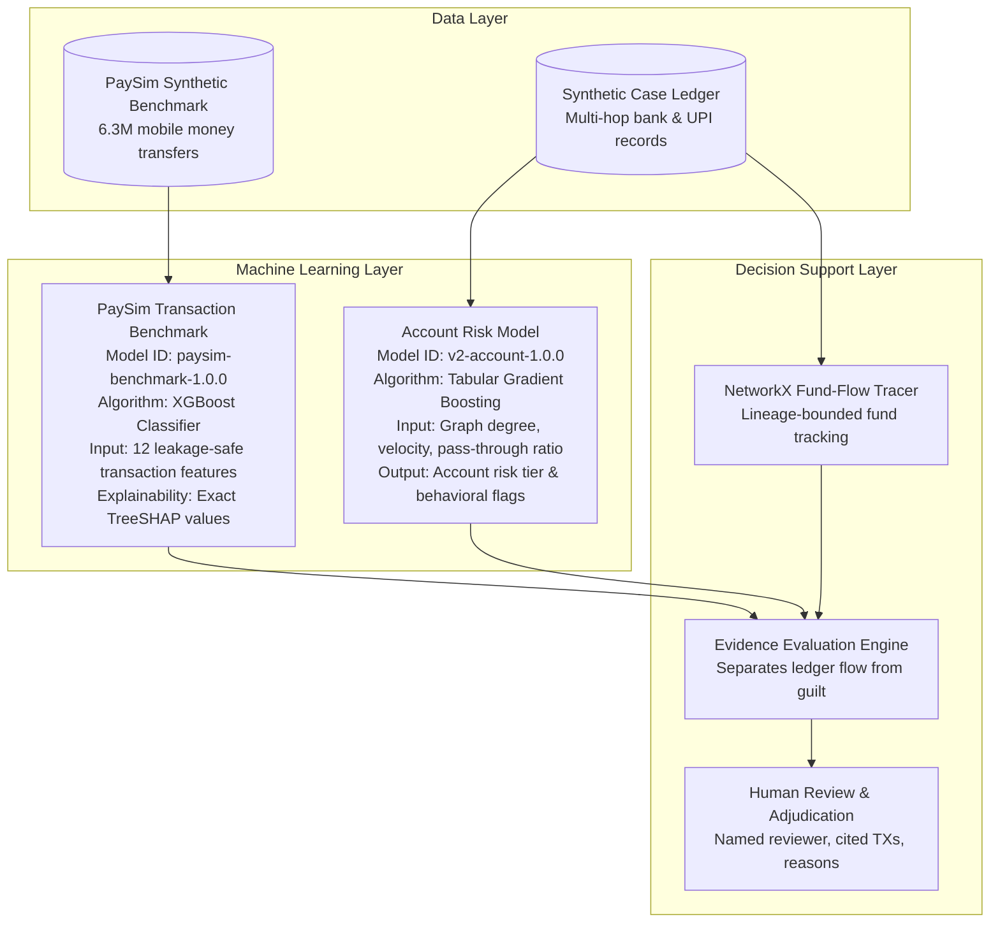
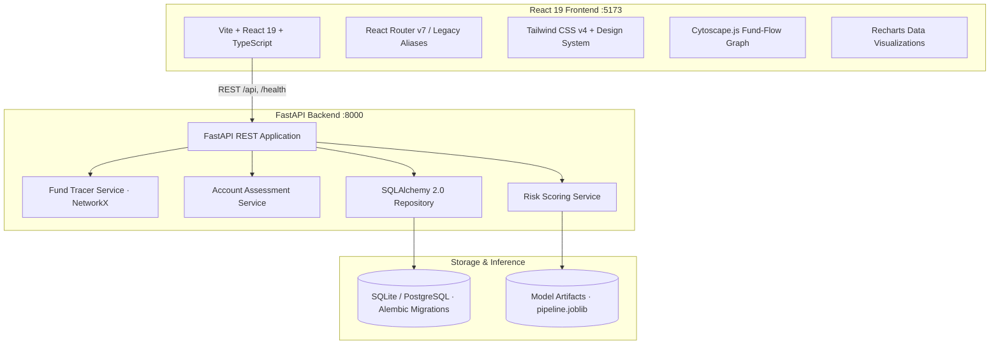

# FraudShield AI

**Trace the flow. Protect the innocent.**

FraudShield AI is an explainable decision-support platform for financial fraud investigators. When a victim reports a fraudulent transfer, stolen funds are rapidly split, layered, and forwarded across multi-hop intermediary accounts. Investigators must (a) follow the money through complex transaction networks, (b) understand *why* predictive models flagged specific transactions or accounts, (c) avoid wrongfully freezing or penalizing accounts that merely received funds without culpable knowledge, and (d) preserve an immutable, transparent audit trail of all human decisions.

FraudShield AI strictly separates six concepts that are frequently conflated and never collapses them into an automated verdict:

1. **Transaction fraud-risk score**: Per-transaction risk estimation with exact local TreeSHAP log-odds explanations.
2. **Account risk profile**: Account-level behavioral classification evaluating velocity, branching, and pass-through ratios.
3. **Observed ledger movement**: Gross incoming and outgoing transaction volume across all recorded network legs.
4. **Traceable fund exposure**: Lineage-bounded fund attribution that safeguards against double-counting downstream transfers.
5. **Evidence quality & gaps**: Explicit distinction between verified documentary evidence and unverified graph connections.
6. **Human investigation outcome**: Attributed review decisions by named investigators with cited transactions and audit provenance.

> **Research Prototype Notice — Synthetic Demonstration Data:** Demo case `FS-1042` and account records are synthetic scenarios created for evaluation and demonstration. The system provides decision-support analysis only: it **never automatically freezes accounts, seizes funds, or declares legal guilt or innocence**.

---

## Major Capabilities

- **Guided Investigation Tour (`/guided`):** Interactive 6-step end-to-end guided walkthrough designed for first-time evaluators to explore intake, fund tracing, account intelligence, explainable risk, adjudication, and audit logs.
- **Interactive Fund Flow Explorer (`/fund-flow`, `/cases/:caseId`):** Cytoscape-powered topological fund-flow visualizer with hierarchical tree layout, pan/zoom canvas controls, path highlighting, cycle detection, and dual table list views.
- **Investigation Case Dossiers (`/cases`, `/cases/:caseId`):** Multi-tab case management workspace featuring incident timelines, transaction registries with payment rail filters (UPI, IMPS, NEFT), linked account rosters, and adjudication panels.
- **Account Intelligence & Evidence Dossier (`/app/account/:id`):** Granular account analysis comparing gross observed movement against lineage-bounded traceable exposure, behavioral signals, and explicit evidence gaps.
- **Model Insights & Explainability Workspace (`/insights`, `/app/transaction-check`):** Model transparency hub displaying global feature importances, confusion matrices, evaluation limitations, and on-demand local TreeSHAP score decompositions (`base_value + Σφ = raw_margin`).
- **Audit & Governance Workspace (`/audit`):** Append-only provenance ledger recording all human reviews, triage status changes, and case events with real-time JSON metadata export.

---

## Two-Model Architecture & Provenance

FraudShield AI operates two distinct model capabilities tailored to different stages of an inquiry:



### Model Distinction & Provenance:
1. **PaySim Transaction Benchmark (`paysim-benchmark-1.0.0`):**
   - **Provenance:** Trained on the open synthetic PaySim benchmark dataset simulating mobile money transfers.
   - **Leakage Prevention:** Strictly excludes post-transaction balance fields (`newbalanceOrig`, `newbalanceDest`) and account identifiers (HTTP 422 on leakage attempts).
   - **Explainability:** Computes exact TreeSHAP contributions where `base_value + Σφ = raw_margin` and `σ(raw_margin) = risk_score`.
2. **Account-Level Model (`v2-account-1.0.0`):**
   - **Provenance:** Trained on synthetic multi-hop ledger features.
   - **Features:** Evaluates structural graph position, inbound/outbound volume asymmetry, pass-through velocity, and fan-out branching.
   - **Safety Boundary:** Account risk classifications do not constitute proof of illicit intent and must be corroborated by external documentation.

---

## Application Architecture



**Technology Stack:**
- **Frontend:** React 19, TypeScript, Vite, Tailwind CSS v4, Cytoscape.js, Recharts, Lucide Icons, Vitest, Testing Library.
- **Backend:** FastAPI, Python 3.12, SQLAlchemy 2.0, Alembic, NetworkX, scikit-learn, XGBoost, SHAP, Pytest.

---

## Local Setup & Quickstart

### Prerequisites
- Python 3.12+
- Node.js 20+ (Node 22 recommended)

### 1. Backend Setup
```bash
cd backend
python3 -m venv .venv
source .venv/bin/activate
pip install -r requirements.txt
alembic upgrade head          # Initializes SQLite database (fraudshield.db)
uvicorn app.main:app --port 8000
```
*Note: On first startup, sample case `FS-1042` and its synthetic transaction graph are automatically seeded.*

### 2. Frontend Setup
```bash
cd frontend
npm install
npm run dev                   # Starts dev server on http://localhost:5173
```
*The Vite frontend automatically proxies `/api` and `/health` requests to `http://localhost:8000`.*

### 3. Running Without Model Binaries
Model binaries are git-ignored (`ml/artifacts/`). If local binaries are not present, the backend cleanly handles prediction requests by returning HTTP 503 (`model_unavailable`), which the frontend displays as an honest indicator without crashing. To train the models locally, refer to [`ml/README.md`](ml/README.md).

---

## Presenter Demonstration Walkthrough

Use sample case **`FS-1042`** for a complete, 7-step end-to-end demonstration:

| Step | Section / Route | Presenter Actions & Narrative |
|---|---|---|
| **1. Introduction** | `/guided` or Header `"Guided Investigation"` | **Explain the Problem:** State what FraudShield AI does. Clarify that in financial cybercrime, stolen funds disperse across multiple hops; investigators must avoid treating innocent merchants or intermediate recipients as co-conspirators. |
| **2. Case Intake** | Step 1 (`/guided?step=1`) or `/cases/FS-1042` | **Inspect Reported Incident:** Review case `FS-1042` (reported ₹50,000 victim transfer). Highlight the explicit disclaimer separating the complainant's claim from ledger-verified transactions. |
| **3. Fund Tracing** | Step 2 (`/guided?step=2`) or `/cases/FS-1042` (Tab: Fund Flow) | **Follow the Money:** Explore the interactive Cytoscape tree topology (`V001 -> A100 -> B200 -> C300`). Demonstrate zoom, pan, and switching between the graphical canvas and tabular transfer list. |
| **4. Account Intelligence** | Step 3 (`/guided?step=3`) or `/app/account/C300` | **Examine Evidence vs. Movement:** Inspect downstream recipient `C300`. Show how gross observed movement (₹30,000) is distinguished from traceable exposure. Highlight explicit evidence gaps (e.g. missing merchant invoices). |
| **5. Model Explanation** | Step 4 (`/guided?step=4`) or `/insights` | **Explain Model Predictions:** Demonstrate TreeSHAP local feature explanations for transaction `T001`. Explain how base log-odds and specific features (amount, transfer type) contributed to the risk score. |
| **6. Human Review** | Step 5 (`/guided?step=5`) or `/cases/FS-1042` (Tab: Review & Audit) | **Record Review Decision:** Select account `C300`, set status to `under_review`, select reason *"Verified commercial invoice / merchant order"*, cite transaction `T003`, enter reviewer ID, and submit. |
| **7. Audit Provenance** | Step 6 (`/guided?step=6`) or `/audit` | **Verify Audit Trail:** Open the Audit & Governance workspace. Confirm the recorded adjudication appears immediately with full timestamp, reviewer attribution, and cited transactions in the append-only log. |

---

## API Reference Overview

| Method | Endpoint | Purpose |
|---|---|---|
| `GET` | `/health` | Service health status and database connectivity |
| `POST` | `/api/risk/score` | Compute transaction fraud-risk score with review recommendation |
| `POST` | `/api/risk/explain` | Return exact TreeSHAP feature importance contributions |
| `GET` | `/api/cases` | List all investigation cases with triage status |
| `POST` | `/api/cases` | Create a new investigation case |
| `GET` | `/api/cases/{id}` | Retrieve comprehensive case details |
| `PATCH` | `/api/cases/{id}` | Update case triage status (`open`, `under_investigation`, `closed`) |
| `GET` | `/api/cases/{id}/trace` | Retrieve multi-hop NetworkX fund trace with hop lineage |
| `GET` | `/api/cases/{id}/graph` | Cytoscape graph nodes and edges for case topology |
| `GET` | `/api/cases/{id}/transactions` | Traced transactions with rail filtering |
| `GET` | `/api/cases/{id}/accounts` | Account assessments for all entities in a case |
| `GET` | `/api/cases/{id}/accounts/{acct}/assessment` | Detailed evidence-aware account dossier |
| `PUT` | `/api/cases/{id}/accounts/{acct}/review` | Record attributed human review decision (appends audit event) |
| `GET` | `/api/cases/{id}/audit-trail` | Append-only audit provenance log for a case |
| `GET` | `/api/audit-events` | Global audit events across all cases |

Interactive Swagger API Documentation: `http://localhost:8000/docs`

---

## Verification & Test Results

All test suites and production builds have been verified:

| Test Suite / Build | Environment / Command | Result |
|---|---|---|
| **Backend Integration & Unit Tests** | `backend/.venv/bin/pytest backend/tests -q` | **150 passed** |
| **ML Inference & TreeSHAP Tests** | `backend/.venv/bin/pytest ml/tests -q` | **32 passed** |
| **Total Python Test Suite** | `backend/.venv/bin/pytest backend/tests ml/tests -q` | **182 passed** |
| **Frontend Unit & Component Tests** | `npm test -- --run` (in `frontend/`) | **79 passed** (10 test files) |
| **Frontend TypeScript & Production Build** | `npm run build` (`tsc -b && vite build`) | **0 errors** (production bundle generated) |
| **Accessibility & Keyboard Navigation** | WCAG 2.1 AA audits across `:focus-visible`, ARIA labels, tablists | **Verified** (no missing keys, full keyboard focus rings) |

---

## Limitations & Ethical Safeguards

- **Synthetic Data Benchmark:** All transactions and case records are synthetic. Real payment rails (UPI/IMPS/NEFT/RTGS) feature proprietary clearing windows and fraud topologies not fully captured by public simulations.
- **Decision Support Exclusively:** FraudShield AI is designed for human investigators. It does not initiate automated account freezes, card cancellations, or fund recovery.
- **Explicit Evidence Separation:** A high machine-learning score or topological graph connection does not constitute legal proof of fraud or illicit intent.
- **Scenario Lineage vs. Commingled Funds:** Demo scenarios assume traceable funds follow explicit lineage tags. In real-world commingled accounts, attribution requires forensic accounting rules.
- **Prototype Authentication:** The prototype uses free-text reviewer attribution for ease of demonstration. Production deployment requires single sign-on (SSO) and role-based access control (RBAC).

---

## Deployment Guidelines (Optional)

FraudShield AI is pre-configured for containerized or serverless hosting:
- **Frontend:** Build static assets (`npm run build`) and host on Cloudflare Pages, Vercel, or Netlify with SPA fallback routing.
- **Backend:** Deploy FastAPI container to Fly.io, Render, or Google Cloud Run using `uvicorn app.main:app --host 0.0.0.0 --port 8000`. Set `CORS_ALLOWED_ORIGINS` to the frontend production domain and point `DATABASE_URL` to PostgreSQL.

See [`backend/README.md`](backend/README.md), [`frontend/README.md`](frontend/README.md), and [`ml/README.md`](ml/README.md) for module-specific details.
