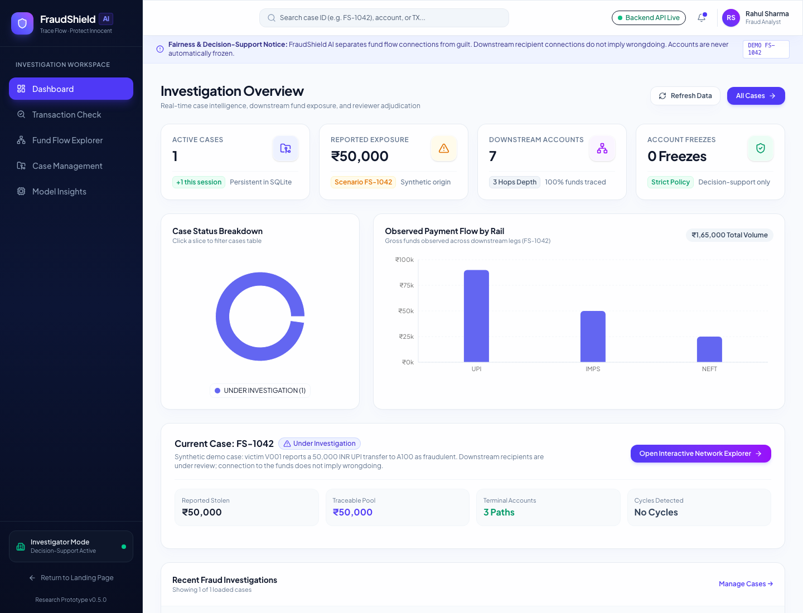
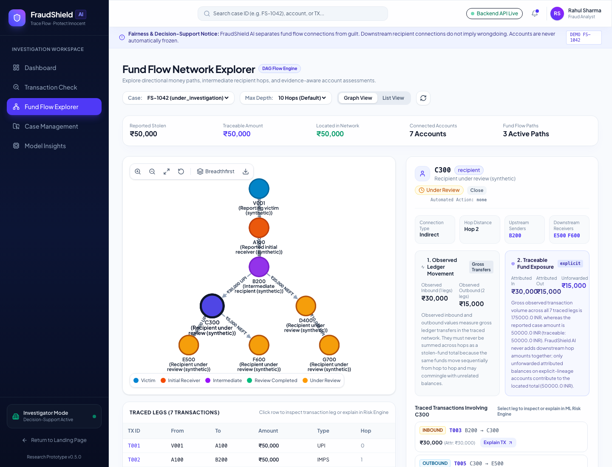
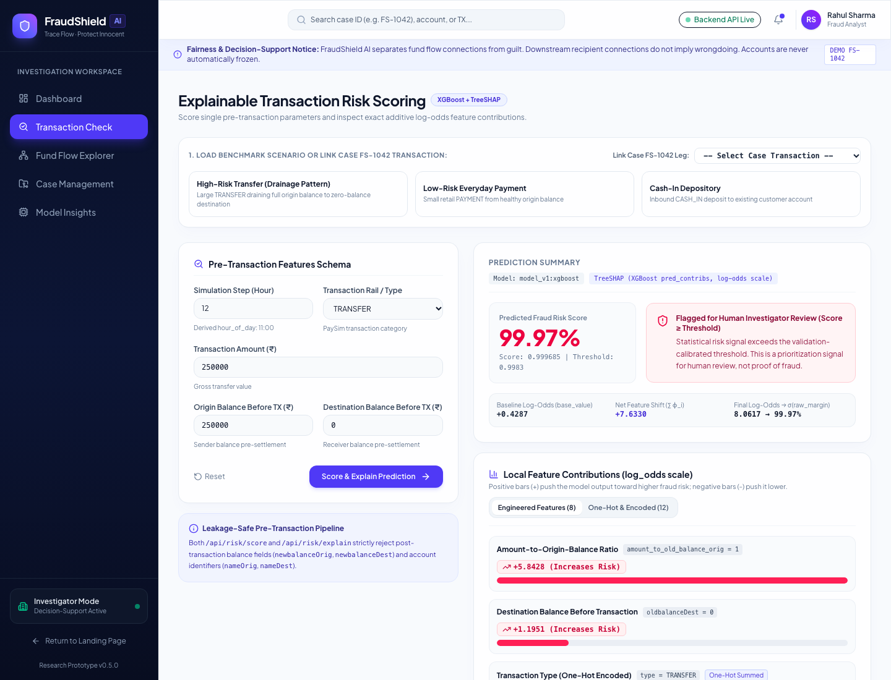
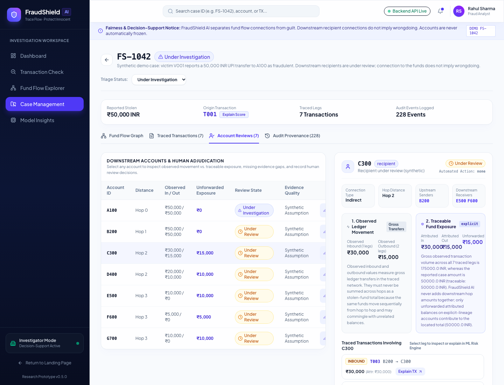
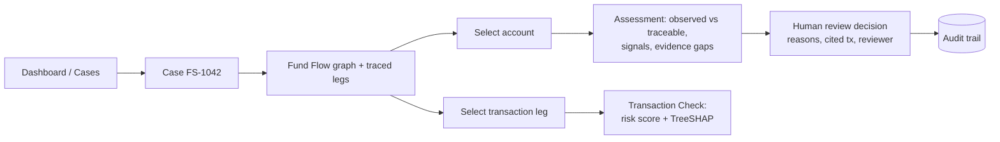
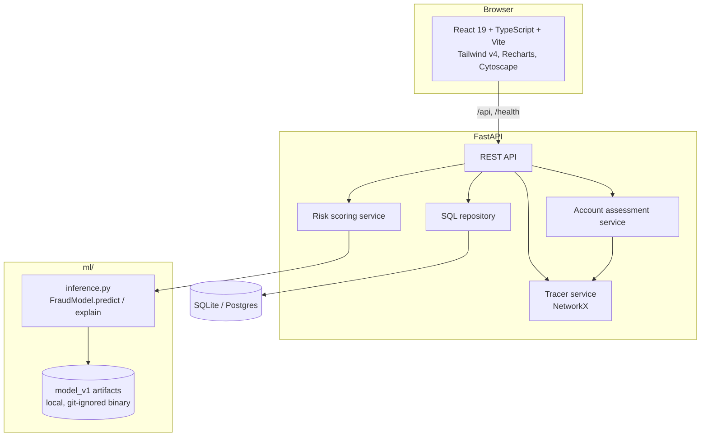

# FraudShield AI

**Trace the flow. Protect the innocent.**

FraudShield AI is a decision-support prototype for fraud investigators. When a victim reports a fraudulent transfer, money is typically split and forwarded through several intermediary accounts. Investigators need to (a) follow that money, (b) understand *why* a model flagged a transaction, and (c) avoid wrongly treating an account that merely *received* funds as complicit.

FraudShield AI separates six concepts that are easy to conflate and never merges them into a verdict:

1. **Transaction fraud-risk score** (XGBoost, with per-prediction TreeSHAP explanation)
2. **Observed transaction movement** (gross ledger flow)
3. **Traceable fund exposure** (lineage-bounded; never sums downstream hops into a larger stolen total)
4. **Evidence quality** (supporting evidence, gaps, uncertainty)
5. **Account review status** (workflow state)
6. **Human investigation outcome** (named reviewer, reasons, cited transactions, audit event)

> **Research prototype. All case data is synthetic.** The demo case `FS-1042` is fabricated for demonstration. The model is trained on the public synthetic **PaySim** dataset. Nothing here is legal evidence, and the system **never freezes accounts or declares anyone guilty or innocent**.

## Screenshots

Captured from the running app (headless Chrome, synthetic data):

| Dashboard | Fund Flow Explorer |
|---|---|
|  |  |
| **Explainable risk check** | **Human review + evidence** |
|  |  |

## Features

- **Fund-tracing engine**: deterministic multi-hop traversal (NetworkX) with path/hop calculation, cycle detection and depth limits.
- **Explainable AI**: `POST /api/risk/explain` returns exact TreeSHAP log-odds contributions (`base_value + Σφ = raw_margin`, `σ(raw_margin) = risk_score`), one-hot `type_*` contributions summed into a single `type` feature, plus the 12 encoded columns.
- **Leakage-safe model**: post-transaction balance fields (`newbalanceOrig`, `newbalanceDest`) and account identifiers are rejected (HTTP 422).
- **Evidence-aware account assessment**: graph position, observed vs traceable amounts, behavioural signals (e.g. rapid pass-through, branching), evidence gaps, uncertainty, and verification guidance. States include `insufficient_evidence`, `graph_connection_only`, `scenario_lineage_assumed`, `human_review_corroborated`.
- **Human review workflow**: status, evidence quality, notes, reviewer, reasons, supporting transaction IDs, "more info needed" flag; every change appends an audit event.
- **Persistence**: SQLAlchemy 2.0 + SQLite (PostgreSQL-compatible), Alembic migrations, append-only audit trail.

## Investigation workflow



## Architecture



**Stack:** FastAPI, SQLAlchemy 2, Alembic, NetworkX, scikit-learn, XGBoost, React 19, TypeScript, Vite, Tailwind CSS v4, Recharts, Cytoscape.js, pytest, Vitest.

## Setup

Prerequisites: Python 3.12, Node 22+.

### Backend

```bash
cd backend
python3 -m venv .venv
source .venv/bin/activate
pip install -r requirements.txt
alembic upgrade head          # creates/updates fraudshield.db (SQLite)
uvicorn app.main:app --port 8000
```

On first start the demo case `FS-1042` is seeded if the database is empty.

### Frontend

```bash
cd frontend
npm install
npm run dev                   # http://localhost:5173 (proxies /api and /health to :8000)
```

### Model artifacts

The risk endpoints need `ml/artifacts/model_v1/pipeline.joblib`. Model binaries and the raw PaySim CSV are **not committed** (see `.gitignore`). To regenerate them locally, download PaySim yourself into `data/raw/` and run the training pipeline (see [`ml/README.md`](ml/README.md)). Without artifacts the app still runs; `/api/risk/*` returns a safe `model_unavailable` (503) error and the UI shows it.

### Environment variables (all optional)

| Variable | Purpose | Default |
|---|---|---|
| `DATABASE_URL` | SQLAlchemy URL | local SQLite file in `backend/` |
| `FRAUDSHIELD_MODEL_DIR` | Model artifact directory | `ml/artifacts/model_v1` |
| `CORS_ALLOWED_ORIGINS` | Comma-separated allowed origins | local dev origins |

No secrets are required. See [`.env.example`](.env.example); never commit a real `.env`.

## API overview

| Method | Path | Purpose |
|---|---|---|
| GET | `/health` | Service status |
| POST | `/api/risk/score` | Fraud-risk score + review recommendation |
| POST | `/api/risk/explain` | Score + TreeSHAP feature contributions |
| GET | `/api/cases`, `/api/cases/{id}` | List / fetch cases |
| GET | `/api/cases/{id}/trace` · `/graph` · `/transactions` | Fund tracing outputs |
| GET | `/api/cases/{id}/accounts` | Assessments for all accounts in a case |
| GET | `/api/cases/{id}/accounts/{acct}/assessment` | Evidence-aware assessment |
| PUT | `/api/cases/{id}/accounts/{acct}/review` | Record a human review (audited) |
| GET | `/api/cases/{id}/audit-trail` | Append-only audit events |

Interactive docs: `http://127.0.0.1:8000/docs`.

## Tests

```bash
# Backend + ML (from repo root)
backend/.venv/bin/pytest backend/tests ml/tests -q

# Frontend unit/component tests and production build
cd frontend && npm test -- --run && npm run build
```

Verified results for this revision are in [Verification](#verification).

## Verification

| Check | Command / Environment | Result |
|---|---|---|
| Backend test suite | `backend/.venv/bin/pytest backend/tests -q` | **106 passed** |
| ML pipeline & TreeSHAP test suite | `backend/.venv/bin/pytest ml/tests -q` | **32 passed** |
| Frontend component & unit tests | `cd frontend && npm test -- --run` | **11 passed** (3 test files) |
| Frontend TypeScript + Vite build | `cd frontend && npm run build` | **0 errors** (`dist/` bundle generated) |
| Live Chrome E2E journey | Google Chrome 155.0.8059.80 via CDP against `http://localhost:5173` + `http://127.0.0.1:8000` | **22/22 assertions passed**, **0 console errors**, **0 failed network requests**, **0px mobile horizontal overflow** (`390×844`) |

## Limitations and safeguards

- **Synthetic data only.** PaySim is a simulation; real fraud patterns, rails (UPI/IMPS/NEFT) and base rates differ. When case legs are scored, the rail is mapped to the nearest PaySim type (e.g. `TRANSFER`) and the UI says so.
- **Statistical signal, not proof.** A high score prioritises human review. SHAP contributions describe the *model's behaviour*, not real-world causation.
- **Lineage is assumed in the demo.** Traceable exposure uses explicit scenario lineage metadata. Real commingled accounts need external accounting rules and bank statements; when lineage is missing the app reports `uncertain_missing_lineage` / `insufficient_evidence` instead of guessing.
- **No automated enforcement.** No freezing, holds, fund transfers, or guilt/innocence labels. All decisions are human, attributed, and audited.
- **Prototype security.** No authentication; reviewer identity is a free-text field. Do not expose publicly with real data.

## Deployment (free tier, optional, not performed)

Nothing has been deployed. Suggested path, no paid resources required:

- **Frontend**: build with `npm run build` and host `frontend/dist` on a static host (Cloudflare Pages, Netlify, Vercel free tier). Set up a rewrite of `/api/*` and `/health` to the backend URL (the Vite dev proxy does not exist in production), and a SPA fallback to `index.html`.
- **Backend**: a free web-service tier (e.g. Render, Fly.io, Railway trial) running `uvicorn app.main:app --host 0.0.0.0 --port $PORT` after `alembic upgrade head`. Set `CORS_ALLOWED_ORIGINS` to the frontend origin. Free tiers have ephemeral disks: SQLite data resets on redeploy, so use a free managed Postgres via `DATABASE_URL` if persistence matters.
- **Model**: binaries are git-ignored. Generate them locally and provide them via a mounted volume/release asset and `FRAUDSHIELD_MODEL_DIR`, or accept `model_unavailable` for a demo without the model.
- Review the synthetic-data and no-authentication limitations above before making any instance public.

See also [`backend/README.md`](backend/README.md), [`frontend/README.md`](frontend/README.md), [`ml/README.md`](ml/README.md).
