# FraudShield AI V2: Data Audit, Benchmark Review & Synthetic Schema
**Phase 1 Forensic Foundation & Data Architecture**

---

## 1. Audit of Existing PaySim Benchmark Dataset

### 1.1 Dataset Identification & Hash
* **File Path**: `data/raw/PS_20174392719_1491204439457_log.csv`
* **File Size**: 493,534,783 bytes (470.7 MB)
* **Cryptographic Hash (SHA-256)**: `16910f90577b0d981bf8ff289714510bb89bc71bff7d3f220f024e287e4eea6b`
* **Integrity Status**: Preserved in raw read-only state. Not modified, truncated, or relocated.

### 1.2 Schema and Field Analysis
The PaySim CSV contains exactly 6,362,620 rows across 11 columns:

```csv
step,type,amount,nameOrig,oldbalanceOrg,newbalanceOrig,nameDest,oldbalanceDest,newbalanceDest,isFraud,isFlaggedFraud
```

| Field Name | Type | Genuine Availability in Banking Production | PaySim Characteristic & Limitations |
| :--- | :--- | :--- | :--- |
| `step` | Integer | Synthetically simulated hourly counter (1–743, ~31 days). | Lacks calendar dates, day-of-week seasonality, real-world business hours, and microsecond timestamps. |
| `type` | String | Standard payment rails (`CASH_IN`, `CASH_OUT`, `DEBIT`, `PAYMENT`, `TRANSFER`). | Useful as categorical rail signal, but covers only mobile money operations, excluding modern rails like UPI, IMPS, RTGS, SWIFT, and Wire. |
| `amount` | Float | Real transaction value in currency units. | Range: 0.00 to 92,445,516.64. Fraud transactions concentrate heavily in high-value transfers (mean: 1.46M vs legit 178K). |
| `nameOrig` | String | Originating account identifier (`C...`). | **Critical limitation**: Ephemeral string. Over 95% of origin accounts appear only once. Impossible to construct 90-day baselines, customer tenure, or historical velocity. |
| `oldbalanceOrg` | Float | Sender balance immediately prior to transfer. | Available at transaction time. |
| `newbalanceOrig` | Float | Sender balance after transfer. | Written *post-settlement*. Using this in pre-transaction risk scoring leaks settlement information. |
| `nameDest` | String | Recipient identifier (`C...` for customer, `M...` for merchant). | Ephemeral string. Merchant destinations (`M...`) have no balance history. |
| `oldbalanceDest` | Float | Recipient balance prior to transfer. | Available only if destination is at the same issuing bank. Often 0 for merchant accounts. |
| `newbalanceDest` | Float | Recipient balance after transfer. | Written post-settlement. Often 0 in PaySim. |
| `isFraud` | Integer (0/1) | Ground-truth fraud label. | **Only 8,213 positive rows (0.129%)**, strictly restricted to `TRANSFER` (4,097) and `CASH_OUT` (4,116). |
| `isFlaggedFraud` | Integer (0/1) | Rule-based flag generated by simulator. | Flagged only 16 rows out of 8,213 frauds. Leaks simulation logic. |

### 1.3 Key Architectural Takeaways from PaySim Audit
1. **Unusable for Account-Centric Investigation**: PaySim accounts have no customer profile, KYC verification tier, contact details, account opening date, or multi-month continuity.
2. **Lacks Multi-Hop Laundering Topologies**: PaySim represents single-hop transfers (`TRANSFER` to `CASH_OUT`). It completely lacks multi-tier layering, smurfing (fan-in), dispersal (fan-out), and cyclic round-tripping.
3. **No Account-Level Labels**: There are zero ground-truth labels for whether an account is a mule, compromised victim, shell entity, or legitimate counterparty.
4. **V2 Role**: Retained exclusively as an external benchmark for transaction-level classifier testing.

---

## 2. Review of IBM AMLSim (Agent-Based Financial Network Simulator)

### 2.1 Overview & Capabilities
IBM AMLSim models synthetic banking networks using multi-agent simulation with parameterizable financial crime typologies:
* **Accounts File (`accounts.csv`)**: `ACCOUNT_ID, CUSTOMER_ID, INIT_BALANCE, START_DATE, END_DATE, COUNTRY, ACCOUNT_TYPE, IS_SAR`.
* **Transactions File (`transactions.csv`)**: `TX_ID, SENDER_ID, RECEIVER_ID, TX_AMOUNT, TIMESTAMP, TX_TYPE, IS_SAR`.
* **Alert / Typology Patterns (`alert_patterns.csv`)**: Identifies explicit AML subgraphs:
  - *Fan-In (Structuring/Aggregation)*: Multiple feeder accounts sending to one collector.
  - *Fan-Out (Dispersal)*: One source dispersing small amounts to multiple recipients.
  - *Forward (Linear Mule Chain)*: Multi-hop serial transfers ($A \to B \to C \to D$).
  - *Cycle (Round-Tripping)*: Closed loop transfers ($A \to B \to C \to A$).
  - *Scatter-Gather (Bipartite / Layering)*: Dispersion followed by consolidation.

### 2.2 Comparison & Lessons for FraudShield AI V2
While AMLSim validates the necessity of graph typologies, its native execution requires a heavy Java toolchain and lacks rich modern retail banking metadata (such as UPI handles, device fingerprints, and KYC tiers).

**V2 Decision**: We incorporate the proven topological models of AMLSim (linear chains, fan-in, fan-out, cycles, and dormant awakening) into a lightweight, fully deterministic, seed-controlled Python generator native to the FraudShield AI codebase.

---

## 3. Real vs. Synthetic Attributes & Ethical Guardrails

### 3.1 Field Provenance Matrix

| Field Category | Simulated / Synthetic Attributes | Genuine Production Analog | Operational Evidentiary Status |
| :--- | :--- | :--- | :--- |
| **Account Identity** | `customer_name`, `phone_number`, `email`, `upi_id`, `tax_identifier` | Core Banking System (CBS) / CRM customer master table. | **Purely synthetic**. Must never be linked to real persons or used in legal filings without live CBS verification. |
| **Compliance & KYC** | `kyc_tier` (`tier_1_basic`, `tier_2_verified`, `tier_3_enhanced`) | Regulated Customer Due Diligence (CDD) records. | **Simulated proxy**. Used only to test risk-weighting algorithms. |
| **Account Status** | `status` (`active`, `dormant`, `suspended`) | CBS account operational status flags. | **Simulation state**. Reflects test scenario parameters. |
| **Transaction Ledger** | `timestamp`, `amount`, `channel`, `balances` | Immutable core banking double-entry ledger. | **Ledger facts** within the simulation boundary. Balances strictly obey double-entry accounting. |
| **Scenario Labels** | `ground_truth_label` (`mule_first_hop`, `compromised_victim`, etc.) | FIU STR/SAR historical filings and law enforcement findings. | **Ground-truth benchmark tags**. Designed to measure precision and recall of V2 models. |

> [!IMPORTANT]
> **Ethical Principle on Synthetic Attributes**:
> Synthetic account fields (names, phone numbers, tax IDs, and KYC tiers) are generated solely to provide a realistic schema for software development and UI layout testing. They must **never** be treated as genuine financial evidence, criminal culpability records, or real human identities.

---

## 4. Synthetic Banking Network Schema

### 4.1 Accounts Schema (`accounts.csv`)

| Column Name | Data Type | Description | Example |
| :--- | :--- | :--- | :--- |
| `account_id` | String (PK) | Unique formatted account identifier. | `ACC-000001` |
| `customer_name` | String | Synthetic full name of account holder. | `Aditi Sharma` |
| `customer_type` | String | Customer category: `retail`, `sme`, `corporate`, `student`. | `retail` |
| `kyc_tier` | String | Due diligence level: `tier_1_basic`, `tier_2_verified`, `tier_3_enhanced`. | `tier_2_verified` |
| `phone_number` | String | Synthetic phone number with country code. | `+91 98765 00001` |
| `email` | String | Synthetic email address. | `aditi.sharma0001@example.bank` |
| `upi_id` | String | Synthetic UPI Virtual Payment Address (VPA). | `aditi0001@okhdfcbank` |
| `tax_identifier` | String | Masked synthetic tax/PAN identifier. | `ABCPS0001K` |
| `initial_balance` | Decimal | Account opening balance at start of simulation. | `54200.00` |
| `current_balance` | Decimal | Balance at end of simulation ($initial + \sum credits - \sum debits$). | `61840.50` |
| `account_opened_at` | String | ISO-8601 account creation date. | `2025-11-14T00:00:00Z` |
| `status` | String | Operational status: `active`, `dormant`, `suspended`. | `active` |
| `scenario_id` | String | Injected scenario identifier (or `None`). | `SCENARIO-APP-001` |
| `ground_truth_label` | String | Controlled benchmark label. | `compromised_victim` |

### 4.2 Transactions Schema (`transactions.csv`)

| Column Name | Data Type | Description | Example |
| :--- | :--- | :--- | :--- |
| `transaction_id` | String (PK) | Unique sequential transaction ID. | `TXN-0000001` |
| `timestamp` | String | ISO-8601 UTC timestamp, strictly chronological. | `2026-01-15T08:14:22Z` |
| `origin_account_id` | String (FK) | Debited sender account ID. | `ACC-000042` |
| `destination_account_id` | String (FK) | Credited receiver account ID. | `ACC-000189` |
| `amount` | Decimal | Transfer amount (2 decimal places, positive). | `12500.00` |
| `currency` | String | ISO currency code. | `INR` |
| `channel` | String | Payment rail: `UPI`, `IMPS`, `NEFT`, `RTGS`, `CARD_POS`, `ATM_CASH_OUT`, `INTERNAL`. | `UPI` |
| `status` | String | Execution status: `COMPLETED`. | `COMPLETED` |
| `origin_balance_before` | Decimal | Origin account balance prior to debit. | `85000.00` |
| `origin_balance_after` | Decimal | Origin account balance after debit ($before - amount$). | `72500.00` |
| `dest_balance_before` | Decimal | Destination account balance prior to credit. | `14200.00` |
| `dest_balance_after` | Decimal | Destination account balance after credit ($before + amount$). | `26700.00` |
| `scenario_id` | String | Associated scenario ID (or `None`). | `SCENARIO-APP-001` |
| `scenario_tag` | String | Contextual stage tag (e.g. `app_scam_hop1`, `baseline_salary`). | `app_scam_hop1` |
| `is_suspicious_scenario` | Boolean | Ground-truth flag (`True` for injected attack, `False` for baseline). | `True` |

---

## 5. Controlled Typology Scenarios & Ground-Truth Definitions

To test forensic fund tracing and mule-detection algorithms, five distinct scenarios are deterministically injected alongside realistic background banking transactions:

```mermaid
graph TD
    subgraph Scenario 1: APP Scam Layering
        S1_V[Victim ACC] -->|Hop 1: 100%| S1_M1[Mule 1 Hop 1]
        S1_M1 -->|Hop 2: 50%| S1_M2[Mule 2 Intermed]
        S1_M1 -->|Hop 2: 48%| S1_M3[Mule 3 Intermed]
        S1_M2 -->|Hop 3: Cashout| S1_T1[Terminal Sink]
        S1_M3 -->|Hop 3: Cashout| S1_T2[Terminal Sink]
    end

    subgraph Scenario 2: Structuring Fan-In
        S2_F1[Feeder 1] -->|< $10k| S2_AGG[Aggregator Mule]
        S2_F2[Feeder 2] -->|< $10k| S2_AGG
        S2_F3[Feeder 3] -->|< $10k| S2_AGG
        S2_AGG -->|Consolidated Transfer| S2_T[Terminal Sink]
    end

    subgraph Scenario 3: Fan-Out Dispersal
        S3_SRC[Compromised Corp] -->|Rapid Splits| S3_M1[Mule Recipient 1]
        S3_SRC -->|Rapid Splits| S3_M2[Mule Recipient 2]
        S3_SRC -->|Rapid Splits| S3_M3[Mule Recipient 3]
        S3_M1 -->|ATM Drain| S3_T1[ATM Cashout]
    end

    subgraph Scenario 4: Cyclic Round-Tripping
        S4_A[Shell A] --> S4_B[Shell B]
        S4_B --> S4_C[Shell C]
        S4_C --> S4_A
    end

    subgraph Scenario 5: Dormant Awakening
        S5_D[Dormant Account 180d] -->|Sudden Inflow + 15m Drain| S5_T[Offshore Sink]
    end
```



### Scenario Details & Labels

| Scenario ID | Name & Typology | Graph Topology | Injected Accounts & Roles | Non-Guilt Protection Rule |
| :--- | :--- | :--- | :--- | :--- |
| `SCENARIO-APP-001` | **APP Scam Layering** | 3-hop directed tree ($1 \to 1 \to 2 \to 2$). | `compromised_victim`, `mule_first_hop`, `mule_intermediate`, `cashout_terminal`. | Legitimate merchants receiving partial payments from intermediate mules remain `legitimate_merchant`. |
| `SCENARIO-STRUCT-002` | **Structuring / Smurfing** | Fan-In ($N \to 1$). | `mule_feeder` (10 accounts, amounts < ₹50k / $10k), `mule_aggregator`, `cashout_terminal`. | Feeders' other legitimate payroll or personal transfers are not labeled fraud. |
| `SCENARIO-DISPERSAL-003` | **Fan-Out Dispersal** | Fan-Out ($1 \to N$). | `compromised_victim` (corporate payroll), `mule_intermediate` (15 student accounts), `cashout_terminal`. | Accounts not actively withdrawing within the rapid window are evaluated on evidence, not guilt-by-association. |
| `SCENARIO-CYCLE-004` | **Cyclic Round-Tripping** | Directed Cycle ($A \to B \to C \to D \to A$). | `shell_roundtripper` (4 business entities exchanging funds repeatedly with negligible fee loss). | External counterparties trading with the shell remain `legitimate_corporate`. |
| `SCENARIO-DORMANT-005` | **Dormant Account Awakening** | Sudden high-value pass-through. | `dormant_awakened_mule` (dormant for 120 days, sudden large inflow, >95% outflow in <20 min). | Dormant accounts reactivated for legitimate small personal utility bills are not flagged. |

---

## 6. Ledger Balance Integrity & Mathematical Simulation Rules

To ensure mathematical and accounting consistency across 350,000+ transactions:
1. **Balance Non-Negativity Rule**: An account can never initiate an outgoing transfer exceeding its available balance ($amount \le origin\_balance\_before$).
2. **Double-Entry State Preservation**: For every transaction $T$:
   $$\Delta balance_{origin} = -amount$$
   $$\Delta balance_{destination} = +amount$$
   $$origin\_balance\_after = origin\_balance\_before - amount$$
   $$dest\_balance\_after = dest\_balance\_before + amount$$
3. **Conservation of Total Money**:
   $$\sum_{i=1}^{N} current\_balance_{i} = \sum_{i=1}^{N} initial\_balance_{i} + \sum \text{External Deposits} - \sum \text{External Withdrawals}$$
4. **Chronological Monotonicity**: Transactions are strictly ordered by timestamp ($timestamp_{k} \le timestamp_{k+1}$).

---

## 7. Generator CLI & Reproducibility Instructions

### Execution Command
The synthetic banking generator is invoked via Python with configurable parameters:

```bash
# Fast Test Run (100 accounts, 1,000 transactions)
backend/.venv/bin/python -m backend.app.data.v2.generator --seed 42 --accounts 100 --transactions 1000 --days 7 --output-dir data/v2_synthetic

# Full Production Run (10,000 accounts, 350,000 transactions, 90 days)
backend/.venv/bin/python -m backend.app.data.v2.generator --seed 42 --accounts 10000 --transactions 350000 --days 90 --output-dir data/v2_synthetic
```

### Determinism Guarantee
Given `--seed 42`, the random number generator produces an **identical, byte-for-byte reproducible dataset** across all runs, ensuring reliable regression testing and scientific benchmark consistency.
