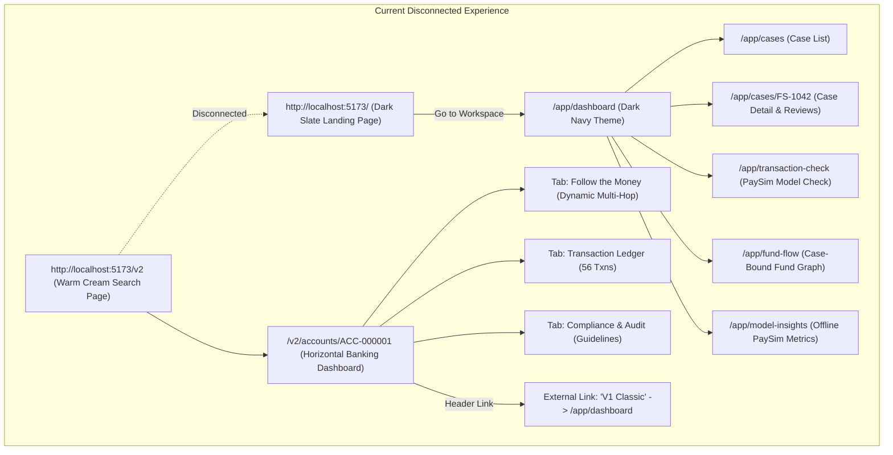
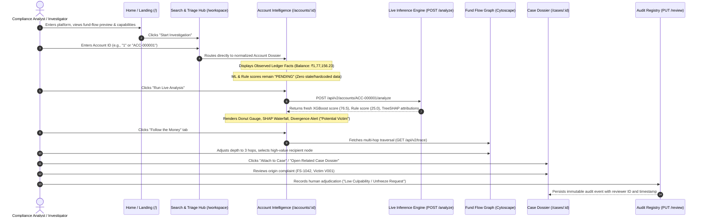
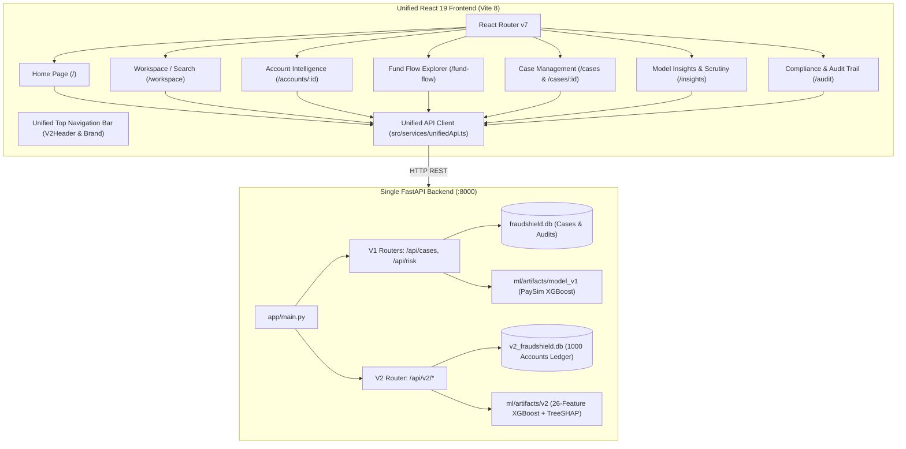
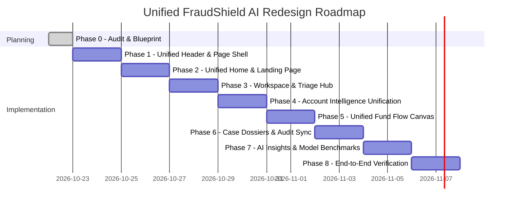

# FraudShield AI — Unified Product Redesign Blueprint & Architecture Plan (Phase 0)

> **Document Status:** Complete Planning Artifact  
> **Target Branch:** `v2-rebuild`  
> **Execution Constraint:** Planning & Auditing Only (Phase 0) — Zero Application Code Modified  
> **Approved Design Theme:** Warm Cream (`#F8F6F0`), Pure White Cards (`#FFFFFF`), Recessed Cream (`#FAF7F2`), Vivid Orange (`#EA8500`)  
> **Architecture Goal:** Unify V1 (Cases, PaySim Transaction Check, Case Tracing, Audits) and V2 (Account Search, 360° Profile, 26-Feature XGBoost ML, TreeSHAP Waterfall, Multi-Hop Cytoscape Lineage) into **ONE cohesive financial forensics platform**.

---

## Table of Contents

1. [Executive Summary & Product Goals](#1-executive-summary--product-goals)
2. [Comprehensive Feature Inventory (V1 & V2)](#2-comprehensive-feature-inventory-v1--v2)
3. [Current Route Map, Navigation Problems & Friction Points](#3-current-route-map-navigation-problems--friction-points)
4. [Proposed Target Sitemap & Unified User Journey](#4-proposed-target-sitemap--unified-user-journey)
5. [Frontend & Backend Integration Architecture](#5-frontend--backend-integration-architecture)
6. [Visual Design System & Reference Dashboard Principles](#6-visual-design-system--reference-dashboard-principles)
7. [Planned Page Layouts, Wireframes & Screen Architecture](#7-planned-page-layouts-wireframes--screen-architecture)
8. [Motion & Animation Strategy (Tailwind CSS, Framer Motion & GSAP)](#8-motion--animation-strategy)
9. [Data Integrity, AI Presentation Rules & Live Inference Protocols](#9-data-integrity-ai-presentation-rules--live-inference-protocols)
10. [Accessibility, Responsive Design & Performance Considerations](#10-accessibility-responsive-design--performance-considerations)
11. [Phase-by-Phase Implementation Plan & Acceptance Criteria](#11-phase-by-phase-implementation-plan--acceptance-criteria)
12. [Testing Strategy, Verification Protocols & Git Delivery Rules](#12-testing-strategy-verification-protocols--git-delivery-rules)
13. [Risks, Hard Constraints & Preservation Register](#13-risks-hard-constraints--preservation-register)

---

## 1. Executive Summary & Product Goals

### 1.1 The Problem: Two Disconnected Applications
FraudShield AI currently operates as two distinct, disjointed experiences living inside the same repository:
- **V1 ("Classic Forensic Workbench"):** A dark-navy/slate dashboard (`/app/*`) organized around specific incident cases (`FS-1042`), single-transaction scoring against the 2017 PaySim mobile-money simulation, static transaction lists, and an append-only human adjudication audit trail.
- **V2 ("Account Intelligence Workspace"):** A warm-cream and vivid-orange suite (`/v2/*`) featuring account-level search, account 360° profiles, dynamic multi-hop fund tracing via Cytoscape, on-demand tabular gradient-boosting inference (`v2-account-1.0.0`) evaluating 26 ledger features, local TreeSHAP waterfall attributions, and non-punitive decision support.

These two apps use completely different navigation bars, conflicting color palettes, divergent terminology ("PaySim Mobile Money" vs "Account Dossier"), and disconnected entry points. A user visiting `http://localhost:5173/` lands on an outdated dark-slate marketing page that links only to V1, completely hiding the advanced account-level intelligence and live ML analysis of V2.

### 1.2 The Mission: One Unified Forensic Financial Intelligence Platform
The objective of this redesign is to merge FraudShield AI into **ONE complete, professional, interactive fraud-investigation platform**. The unified product will:
1. **Unify Navigation & Layout:** Provide a single top-level header and consistent page shell across the entire platform, eliminating the jarring jump between dark-navy V1 and warm-cream V2.
2. **Harmonize Visual Identity:** Standardize the approved warm cream (`#F8F6F0`), crisp white card (`#FFFFFF`), and vivid orange (`#EA8500`) theme across all screens, replacing dark slate with clean, modern financial typography.
3. **Bridge the Investigation Gap:** Connect high-level case intake (`/cases`) seamlessly with deep account intelligence (`/accounts/:id`), transaction-level scrutiny (`/transactions`), interactive lineage graphs (`/fund-flow`), and audit tracking (`/audit`).
4. **Preserve All Backend & ML Capabilities:** Maintain 100% of the working backend APIs (both `app.api.routes` and `app.api.v2.routes`), both SQLite databases (`fraudshield.db` and `v2_fraudshield.db`), and both trained ML models (`model_v1:xgboost` and `v2-account-1.0.0`).
5. **Enforce Non-Punitive Guardrails:** Uphold the fundamental principle that algorithmic risk scores and network proximity to fraud are probabilistic signals for human review—not grounds for automated account freezing or guilt.

---

## 2. Comprehensive Feature Inventory (V1 & V2)

Every existing capability in the codebase has been audited directly against the active source code, backend routes, schemas, and database seeds.

### 2.1 V1 Feature Inventory (Verified in Codebase)

| Feature | Route / Component | Backend Endpoints | Dependencies / DB | Operational Status | Overlap / Role in Unified App |
|---|---|---|---|---|---|
| **Marketing Landing Page** | `/` (`LandingPage.tsx`) | None (static client data) | Hardcoded `PREVIEW_NODES` (`V001`-`I900`) | Works, but visually outdated (dark slate) and links only to V1. | Needs full redesign to become the unified product homepage. |
| **Investigation Dashboard** | `/app/dashboard` (`DashboardPage.tsx`) | `GET /api/cases`, `GET /api/cases/{id}/trace`, `GET /api/cases/{id}/transactions` | `fraudshield.db` (`SqlCaseRepository`) | Fully functional. Shows case summary metrics, exposure bar chart, payment rail breakdown. | Overlaps with V2 metrics. To be unified into the Workspace / Triage Hub. |
| **Case Management & List** | `/app/cases` (`CasesPage.tsx`) | `GET /api/cases`, `POST /api/cases`, `PATCH /api/cases/{id}` | `fraudshield.db` (`fraud_cases` table) | Fully functional. Allows filtering, searching cases, and creating new cases. | Essential. Retained as the Case Management module in the unified navigation. |
| **Case Detail & Evidence** | `/app/cases/:caseId` (`CaseDetailPage.tsx`) | `GET /api/cases/{id}`, `GET /api/cases/{id}/graph`, `GET /api/cases/{id}/audit-trail`, `PUT /api/cases/{id}/accounts/{accId}/review` | `fraudshield.db`, `AccountProtectionPanel` | Fully functional. Includes 4 tabs (Overview, Transactions, Reviews, Audit). | Core functionality. Re-skinned in warm cream theme; connects to account profiles. |
| **Transaction Check** | `/app/transaction-check` (`TransactionCheckPage.tsx`) | `POST /api/risk/score`, `POST /api/risk/explain` | `ml/artifacts/model_v1` (`RiskScoringService`) | Fully functional. Scores single PaySim transactions with TreeSHAP feature bars. | Transaction-level engine. Retained as "Transaction Scrutiny" tool under Insights / Tools. |
| **Case Fund Flow** | `/app/fund-flow` (`FundFlowPage.tsx`) | `GET /api/cases/{id}/graph`, `GET /api/cases/{id}/trace` | `CytoscapeGraph.tsx` (legacy wrapper) | Functional, but limited to case `FS-1042` DAG paths. | Superseded by V2 dynamic multi-hop Cytoscape graph. |
| **Model Insights & Benchmark** | `/app/model-insights` (`ModelInsightsPage.tsx`) | `GET /api/v2/models/status` | Offline PaySim test metrics (918k rows) | Fully functional. Confusion matrix, ROC-AUC (0.9999), PR-AUC. | Retained and expanded to compare V1 PaySim benchmark vs V2 Account Model. |
| **Human Review & Audit Trail** | Embedded in `CaseDetailPage.tsx` | `GET /api/cases/{id}/audit-trail`, `PUT /api/cases/{id}/accounts/{accId}/review` | `audit_events`, `account_reviews` tables | Fully functional. Records reviewer ID, evidence quality, notes, and reasons. | Core compliance engine. Extended to link to V2 accounts. |

### 2.2 V2 Feature Inventory (Verified in Codebase)

| Feature | Route / Component | Backend Endpoints | Dependencies / DB | Operational Status | Overlap / Role in Unified App |
|---|---|---|---|---|---|
| **Account Search Workspace** | `/v2` (`V2SearchPage.tsx`) | `GET /api/v2/accounts/{id}` | Client ID normalization, `v2_fraudshield.db` | Fully functional. Quick search, normalization, risk filter pills, recent cards. | Serves as the primary Investigation Search / Triage Hub in unified app. |
| **Account 360° Profile** | `/v2/accounts/:id` (`V2AccountDetailPage.tsx`) | `GET /api/v2/accounts/{id}` | `v2_fraudshield.db` (`accounts` table, 1000 accounts) | Fully functional. KYC tier, balances, counterparty count, status, profile details. | Primary investigation destination for any account. |
| **Banking Hero & Balance Card** | `V2BankingHeroHeader.tsx` | Embedded in account detail | `V2AccountProfileResponse` | Fully functional. INR balance, eye toggle, in/out totals, action buttons. | Row 1 hero element of unified Account Intelligence. |
| **3-Column Banking Dashboard** | `V2BankingDashboardRow.tsx` | Embedded in account detail | `V2AccountLiveAnalysisResponse` | Fully functional. Donut gauge, SHAP bars, recent transactions, peak transfer. | Row 2 core overview of unified Account Intelligence. |
| **Live Account Analysis (Fresh ML)** | `POST /api/v2/accounts/{id}/analyze` | `POST /api/v2/accounts/{id}/analyze` | `AccountLiveAnalysisService`, `ml/artifacts/v2` | Fully functional. On-demand 26-feature XGBoost inference + TreeSHAP attributions. | Most critical live feature. Zero precomputed/stale scores on initial view. |
| **Multi-Hop Fund Tracing Graph** | `V2CytoscapeGraph.tsx` (Tab 2) | `GET /api/v2/trace` | Cytoscape.js, dynamic BFS/DFS, cycle detection | Fully functional. Interactive pan/zoom, depth slider, direction filters, node drawer. | Primary interactive Fund Flow tool for the entire unified product. |
| **Transaction Ledger** | Tab 3 in `V2AccountDetailPage.tsx` | `GET /api/v2/accounts/{id}/transactions` | Paginated double-entry ledger | Fully functional. Inbound/outbound badges, running balance, channel filters. | Core evidence table. Reusable wherever transaction lists appear. |
| **Interactive Risk Visualizations** | `V2TransactionHistogram.tsx`, `V2ActivityTimeline.tsx`, `V2TreeShapBreakdown.tsx` | Live analysis & transaction responses | Recharts, SVG, TreeSHAP waterfall | Fully functional. Clean responsive charts, divergence callout, non-punitive advice. | Integrated into Account Details and Analytics views. |

---

## 3. Current Route Map, Navigation Problems & Friction Points



### 3.1 Critical Navigation & UX Deficiencies
1. **The "Two-Headed Monster" Architecture:** Users entering `/` are thrust into an old, dark-slate landing page that only links to `/app/dashboard`. They never discover `/v2` unless they manually know to append `/v2` to the URL.
2. **Visual & Theme Schizophrenia:** Navigating from `/v2/accounts/ACC-000001` (warm cream `#F8F6F0`, vivid orange `#EA8500`) to `/app/dashboard` or `/app/cases` suddenly loads a dark navy sidebar (`#070C16`) with teal and slate borders. It feels like navigating between two completely different software vendors.
3. **Information Silos & Redundant Fund Flow Tools:** 
   - `/app/fund-flow` runs a legacy Cytoscape instance hardcoded to case `FS-1042`.
   - `/v2/accounts/:id` (Tab 2) runs an advanced Cytoscape instance supporting dynamic BFS traversal from *any* of the 1,000 accounts.
   - The user cannot easily trace funds from a case to an account or from an account to an official case dossier.
4. **Model Level Confusion:**
   - `/app/transaction-check` scores individual transaction rows using PaySim features (`step`, `type`, `oldbalanceOrg`).
   - `/v2/accounts/:id` scores complete account profiles using 26 behavioral ledger features (`rapid_pass_through_ratio`, `fan_in_fan_out_ratio`).
   - Analysts need a clear explanation of *when* to use transaction-level screening vs *when* to use account-level behavioral intelligence.
5. **Human Review Persistence Disconnect:**
   - In V1, human review actions are saved permanently to `fraudshield.db` via `PUT /api/cases/{case_id}/accounts/{account_id}/review`, generating immutable audit records.
   - In V2, the "Compliance & Audit" tab displayed review guidelines and next-step recommendations, but did not persist investigator determinations into the database.

---

## 4. Proposed Target Sitemap & Unified User Journey

### 4.1 The Unified Target Sitemap

The application will be unified under a single responsive navigation header and cohesive layout shell, preserving backwards-compatibility aliases for legacy bookmarks.

```
/ (Home)
  ├── /workspace (Investigation Search & Triage Hub)
  ├── /accounts/:accountId (Account 360° Intelligence & Live Forensics)
  │     ├── [Tab] Overview & Analytics (Banking Hero, 3-Col Dashboard, SHAP Waterfall)
  │     ├── [Tab] Follow the Money (Interactive Cytoscape Multi-Hop Graph)
  │     ├── [Tab] Transaction Ledger (Searchable, Filterable Double-Entry Ledger)
  │     └── [Tab] Compliance & Decision (Evidence Checklist & Audit Recording)
  ├── /fund-flow (Interactive Multi-Hop Fund Lineage Explorer)
  ├── /cases (Case Management Dossiers & Regulatory Triage)
  │     └── /cases/:caseId (Case Dossier, Account Graph & Adjudication Audit)
  ├── /insights (AI Models, Explainability & PaySim Benchmarks)
  │     ├── [Tab] Account Model (v2-account-1.0.0 Architecture & Metrics)
  │     ├── [Tab] Transaction Scrutiny (Interactive PaySim Single-Tx Scoring)
  │     └── [Tab] Benchmarks & Drift (Comparative Confusion Matrices & PR-AUC)
  └── /audit (Compliance Audit Trail & Human Decision Log)
```

### 4.2 Complete End-to-End User Journey



### 4.3 Detailed Route Specifications

#### 1. Home (`/`)
- **Plain English Purpose:** Professional introduction to FraudShield AI's dual-engine forensics (Rules + XGBoost + TreeSHAP) with an interactive preview of fund-flow tracing and direct entry into active investigations.
- **Target Persona & Actions:** Fraud Managers, Compliance Officers, Bank Regulators. Primary action: Click **"Start Investigation"** or enter an account directly in the hero search bar.
- **Reused Features:** Replaces dark V1 `LandingPage.tsx` using V2's animated fund-flow preview (`V2MoneyFlowVisual.tsx`), key metrics counters, and forensic evidence principles.
- **APIs Required:** `GET /health`, `GET /api/v2/models/status`.
- **Above the Fold:** Headline, value proposition, animated fund-flow canvas, quick search bar with example account pills, live model status pill (`v2-active`).

#### 2. Workspace / Triage Hub (`/workspace`, with `/v2` alias)
- **Plain English Purpose:** The central investigative launching pad where analysts search accounts, review recent lookups, inspect triage tiers, and access high-risk queue items.
- **Target Persona & Actions:** Triage Investigators. Actions: Search accounts, filter accounts by risk level (High / Medium / Low), click quick-access sample accounts (`ACC-000001` Aditi Joshi, `ACC-000002` Sara Bhat, `ACC-000007` Vikram Malhotra).
- **Reused Features:** Evolves `V2SearchPage.tsx` into the unified platform workspace. Reuses `normalizeAccountId()`, recent searches cache, and scenario preview cards.
- **APIs Required:** `GET /api/v2/accounts/{id}`, `GET /api/cases`.
- **Above the Fold:** Compact search bar, KYC status tags, active filter pills, 3 quick-start dossier cards with real ledger stats.

#### 3. Account Intelligence & Forensics (`/accounts/:accountId`, with `/v2/accounts/:accountId` alias)
- **Plain English Purpose:** The core 360° forensic dossier for any individual bank account, providing ledger totals, fresh model inference, TreeSHAP contribution bars, and interactive flow visualization.
- **Target Persona & Actions:** Senior Fraud Investigators. Actions: Review balance and counterparties, execute fresh on-demand ML analysis, explore TreeSHAP waterfall, trace fund flow, inspect ledger transactions, record compliance decisions.
- **Reused Features:** Reuses `V2BankingHeroHeader.tsx`, `V2BankingDashboardRow.tsx`, `V2RiskComparisonMeters.tsx`, `V2TransactionHistogram.tsx`, `V2ActivityTimeline.tsx`, `V2TreeShapBreakdown.tsx`, `V2NextStepsRecommendation.tsx`.
- **APIs Required:** `GET /api/v2/accounts/{id}`, `POST /api/v2/accounts/{id}/analyze`, `GET /api/v2/accounts/{id}/transactions`, `GET /api/v2/trace`.
- **Above the Fold:** Row 1 Hero (Active Balance ₹1,77,156.23 + ML Model Prediction card) and Row 2 Dashboard (Risk Gauge, Top Feature Bars, Recent Transactions).

#### 4. Fund Flow Lineage (`/fund-flow`)
- **Plain English Purpose:** Full-screen interactive graph canvas allowing investigators to trace money across multi-hop banking networks, highlight money mules, detect circular loops, and inspect connection paths.
- **Target Persona & Actions:** Forensic Network Analysts. Actions: Pan, zoom, click nodes to view account drawer, adjust hop depth (1–5), toggle flow direction (outgoing/incoming/both), filter by minimum transfer amount.
- **Reused Features:** Merges V1 `CytoscapeGraph.tsx` into V2's richer `V2CytoscapeGraph.tsx` with edge labeling, channel icons (UPI/IMPS/NEFT), cycle indicators, and selected node inspect drawer.
- **APIs Required:** `GET /api/v2/trace`, `GET /api/cases/{id}/graph`.

#### 5. Case Dossiers (`/cases` & `/cases/:caseId`)
- **Plain English Purpose:** Official incident case files documenting reported victim losses, origin transactions, linked downstream accounts, and regulatory compliance evidence.
- **Target Persona & Actions:** Case Officers and Legal Compliance Staff. Actions: Create new case, filter cases by status (under investigation / closed), inspect case timeline, view connected accounts, update investigation status.
- **Reused Features:** Re-skins V1 `CasesPage.tsx` and `CaseDetailPage.tsx` with the warm cream and vivid orange theme. Reuses `AccountProtectionPanel.tsx` for structured human adjudication.
- **APIs Required:** `GET /api/cases`, `POST /api/cases`, `GET /api/cases/{id}`, `PATCH /api/cases/{id}`, `GET /api/cases/{id}/audit-trail`.

#### 6. AI Insights & Benchmarks (`/insights`, with `/app/model-insights` alias)
- **Plain English Purpose:** Model transparency center displaying model architectures, evaluation metrics on held-out test splits, ROC/PR curves, confusion matrices, and interactive single-transaction scoring.
- **Target Persona & Actions:** ML Engineers, Model Risk Auditors, Compliance Directors. Actions: Inspect `v2-account-1.0.0` vs PaySim benchmark metrics, test single transaction scenarios with TreeSHAP explanations.
- **Reused Features:** Combines V1 `ModelInsightsPage.tsx`, V1 `TransactionCheckPage.tsx` (as a sub-tab), and V2 `GET /api/v2/models/status`.
- **APIs Required:** `GET /api/v2/models/status`, `POST /api/risk/score`, `POST /api/risk/explain`.

#### 7. Compliance & Audit Trail (`/audit`)
- **Plain English Purpose:** Immutable chronological log of all analyst actions, case status modifications, account reviews, and evidence notes.
- **Target Persona & Actions:** Compliance Auditors, Regulatory Examiners. Actions: Filter audit records by date, user ID, case ID, or action type; export audit logs for compliance filings.
- **Reused Features:** Unifies V1 audit trail (`GET /api/cases/{id}/audit-trail`) and V2 compliance event persistence.

---

## 5. Frontend & Backend Integration Architecture



### 5.1 Route Mapping & Backward-Compatibility Aliases

All legacy routes will continue to function seamlessly via React Router redirects or unified views:

| Legacy Route | Target Unified Route | Handling Strategy |
|---|---|---|
| `/` | `/` | Replaced with modern warm cream unified Home page. |
| `/v2` | `/workspace` | Redirect to `/workspace` (with route alias). |
| `/v2/accounts/:id` | `/accounts/:id` | Redirect to `/accounts/:id` (with route alias). |
| `/app/dashboard` | `/workspace` | Redirect to `/workspace`. |
| `/app/cases` | `/cases` | Re-skinned into unified Case Management view. |
| `/app/cases/:id` | `/cases/:id` | Re-skinned into unified Case Dossier view. |
| `/app/fund-flow` | `/fund-flow` | Upgraded to use dynamic multi-hop Cytoscape engine. |
| `/app/transaction-check`| `/insights?tab=scrutiny` | Embedded as the Transaction Scrutiny tool inside `/insights`. |
| `/app/model-insights` | `/insights` | Re-skinned into unified AI Insights center. |

### 5.2 Component Reusability Matrix

| Component | Current Location | Plan for Unified App |
|---|---|---|
| `V2BankingHeroHeader.tsx` | `src/components/v2/` | **Keep as Core Component**: Row 1 hero on Account page. |
| `V2BankingDashboardRow.tsx` | `src/components/v2/` | **Keep as Core Component**: Row 2 3-col cards on Account page. |
| `V2CytoscapeGraph.tsx` | `src/components/v2/` | **Keep as Core Component**: Powers both Account Tab 2 and `/fund-flow`. |
| `V2TreeShapBreakdown.tsx` | `src/components/v2/` | **Keep as Core Component**: TreeSHAP waterfall with interactive sorting. |
| `V2RiskComparisonMeters.tsx`| `src/components/v2/` | **Keep as Core Component**: Side-by-side ML vs Rule meters. |
| `V2TransactionHistogram.tsx`| `src/components/v2/` | **Keep as Core Component**: Transaction amount distribution chart. |
| `V2ActivityTimeline.tsx` | `src/components/v2/` | **Keep as Core Component**: 30-day chronological activity heatmap. |
| `V2NextStepsRecommendation.tsx`| `src/components/v2/`| **Keep as Core Component**: Non-punitive decision support guide. |
| `AccountProtectionPanel.tsx`| `src/components/investigation/`| **Re-skin**: Adapt colors from dark teal to warm cream/orange and reuse for audit recording. |
| `CytoscapeGraph.tsx` (legacy)| `src/components/network/` | **Retire**: Migrate all graph rendering to `V2CytoscapeGraph.tsx`. |
| `Sidebar.tsx` (V1 dark navy) | `src/components/layout/` | **Retire**: Replace with unified responsive top navbar (`V2Header.tsx`). |
| `AppLayout.tsx` (V1 layout) | `src/components/layout/` | **Refactor**: Update to use warm cream theme shell and unified navbar. |

### 5.3 Backend API Integration & Zero-Rebuild Strategy
No backend code needs to be destroyed or rewritten:
- The FastAPI backend in `backend/app/main.py` already includes both V1 routers (`app.api.routes`, `app.api.risk`) and V2 routers (`app.api.v2.routes`).
- Both SQLite databases (`backend/fraudshield.db` and `data/v2_fraudshield.db`) exist and are populated with rich demo data.
- The unified frontend service client (`src/services/unifiedApi.ts`) will export a consolidated typed client wrapping both `api` (V1) and `v2Api` (V2), providing clean single-call ergonomics for all pages.

---

## 6. Visual Design System & Reference Dashboard Principles

### 6.1 Approved Color Palette

| Token Name | Hex Code | Tailwind Equivalent | Usage / Application |
|---|---|---|---|
| **Canvas Background** | `#F8F6F0` | Custom `bg-[#F8F6F0]` | Global page canvas, warm, welcoming, modern fintech aesthetic. |
| **Surface Card** | `#FFFFFF` | `bg-white` | Elevated primary cards, panels, modals, dropdowns. |
| **Recessed Surface** | `#FAF7F2` | Custom `bg-[#FAF7F2]` | Inset metric boxes, code blocks, tab track, subtle nested cards. |
| **Primary Orange** | `#EA8500` | Custom `bg-[#EA8500]` | Primary action buttons, active tab indicators, high-risk accents. |
| **Hover Orange** | `#D27400` | Custom `hover:bg-[#D27400]`| Hover state for primary buttons and interactive links. |
| **Orange Tint / Wash** | `#FFF4E6` | Custom `bg-[#FFF4E6]` | Subtle highlight badges, icon backdrops, active step cards. |
| **Border Stroke** | `#EAE3D6` | Custom `border-[#EAE3D6]`| Subtle 1px dividers, card boundaries, table cell borders. |
| **Primary Text** | `#1A1714` | Custom `text-[#1A1714]` | High-contrast headings, active ledger figures, card titles. |
| **Secondary Text** | `#6B655B` | Custom `text-[#6B655B]` | Subtitles, labels, timestamps, counterparty descriptions. |
| **Muted Text** | `#8C857B` | Custom `text-[#8C857B]` | Captions, table footers, inactive navigation icons. |
| **Success Mint** | `#10B981` / `#EAF7EE`| Custom `text-[#166534]` | Inbound payments, verified KYC badges, low risk indicators. |
| **Warning Amber** | `#F59E0B` / `#FEF3C7`| Custom `text-[#B45309]` | Elevated risk, rule divergence flags, human review required. |
| **Danger Rose** | `#EF4444` / `#FEE2E2`| Custom `text-[#991B1B]` | High risk scores (>70/100), critical anomaly alerts. |
| **Accent Lavender** | `#8B5CF6` / `#F3E8FF`| Custom `text-[#6D28D9]` | ML model version badges, TreeSHAP statistical indicators. |

### 6.2 Typography & Proportions
- **Display & Headings:** `font-display` (Inter / system sans), weights 700 to 900, tight tracking (`tracking-tight`).
- **Body & Labels:** `font-sans` (Inter), weights 400 to 600, leading relaxed for readability.
- **Financial Figures & IDs:** `font-mono`, weights 700 to 900 for ledger amounts (`₹1,77,156.23`), weights 500 for Account/Tx IDs (`ACC-000001`, `TXN-0062181`).
- **Card Proportions:** 
  - Standard card corner radius: `rounded-3xl` (24px) for major cards, `rounded-2xl` (16px) for nested cards.
  - Border thickness: crisp 1px (`border border-[#EAE3D6]`), with subtle shadow `shadow-xs`.
  - Padding: `p-6` to `p-7` on desktop, `p-4` on mobile.

### 6.3 Reference Dashboard Layout Rules (Adapted from Banking Reference)
1. **Horizontal First, Vertical Last:** Avoid long vertical report towers. Arrange primary metrics in horizontal side-by-side cards (e.g., Row 1 ~62% Balance Hero + ~38% Intelligence Card; Row 2 three equal 1/3 columns).
2. **Above-the-Fold Completeness:** At 1440x900 resolution, the investigator must see the account profile, balance, active model score, risk donut gauge, top SHAP drivers, and recent ledger activity *without scrolling*.
3. **Restrained Data Density:** Use whitespace, subtle dividers (`#EAE3D6`), and pill badges rather than dense borders and dark boxes.

---

## 7. Planned Page Layouts, Wireframes & Screen Architecture

### 7.1 Unified Page Header Architecture (`V2Header.tsx`)
```
+---------------------------------------------------------------------------------------------------------+
| [Shield Icon] FraudShield AI [v2-active]  |  [ Search Account or Case... (Cmd+K) ]  |  [Status Pill]   |
|                                                                                                         |
|   Home     Workspace     Accounts     Fund Flow     Case Dossiers     AI Insights     Compliance Audit  |
+---------------------------------------------------------------------------------------------------------+
```

### 7.2 Home Page Layout (`/`)
```
+---------------------------------------------------------------------------------------------------------+
| [Hero Section]                                                                                          |
| Forensic Financial Intelligence & Innocent Account Protection                                           |
| "Separating Criminal Fund Flows from Innocent Commercial Counterparties with Explainable AI"            |
|                                                                                                         |
| [ Start Investigation -> ]   [ View Demo Case (FS-1042) ]   [ Model Benchmarks ]                        |
|                                                                                                         |
| +-----------------------------------------------------------------------------------------------------+ |
| | [Animated Multi-Hop Fund Flow Lineage Canvas (V2MoneyFlowVisual.tsx)]                               | |
| | Victim V001 (UPI ₹50k) ---> Initial Receiver A100 (IMPS) ---> Commingled Pass-Through C300 (₹15k)  | |
| +-----------------------------------------------------------------------------------------------------+ |
|                                                                                                         |
| [3 Core Pillars: 1. Ledger Truth  |  2. Explainable TreeSHAP  |  3. Non-Punitive Human Adjudication]   |
+---------------------------------------------------------------------------------------------------------+
```

### 7.3 Workspace / Search & Triage Hub (`/workspace`)
```
+---------------------------------------------------------------------------------------------------------+
| [Triage Header] Investigation Workspace: Search Accounts & Active Cases                                |
|                                                                                                         |
| [ Search input: "ACC-000001" or "FS-1042"... ]  [ Search Button ]                                      |
| Quick Access: (ACC-000001 High) (ACC-000002 Divergent) (ACC-000007 Low) (FS-1042 Active Case)           |
|                                                                                                         |
| Filter: [ All (1,000) ]  [ High Risk (84) ]  [ Divergent Findings (19) ]  [ Low Risk (897) ]           |
|                                                                                                         |
| +-------------------------+ +-------------------------+ +-------------------------+                     |
| | ACC-000001 (Retail)     | | ACC-000002 (Corporate)  | | ACC-000007 (Retail)     |                     |
| | Aditi Joshi             | | Sara Bhat               | | Vikram Malhotra         |                     |
| | Balance: ₹1,77,156.23   | | Balance: ₹4,89,120.00   | | Balance: ₹82,400.00     |                     |
| | 56 Txns · Tier 2        | | 142 Txns · Tier 3       | | 28 Txns · Tier 1        |                     |
| | [ Open Dossier -> ]     | | [ Open Dossier -> ]     | | [ Open Dossier -> ]     |                     |
| +-------------------------+ +-------------------------+ +-------------------------+                     |
+---------------------------------------------------------------------------------------------------------+
```

### 7.4 Account Intelligence & Forensics Page (`/accounts/:accountId`)
```
+---------------------------------------------------------------------------------------------------------+
| [Back to Search] / ACC-000001                                                Workspace: V2 Forensics   |
|                                                                                                         |
| [Avatar] Aditi Joshi  [Active]  |  Overview & Analytics  Follow the Money  Ledger (56)  Compliance Audit|
|                                                                                                         |
| [ ROW 1: HERO DUAL CARDS (~62% / ~38%) ]                                                                |
| +---------------------------------------------------+ +-----------------------------------------------+ |
| | [INR] [RETAIL] [TIER 2 VERIFIED]  Acc: ACC-000001 | | [MODEL ACTIVE]                 v2-account-1.0 | |
| | Active Ledger Balance: ₹1,77,156.23 [eye]        | | ML Model Prediction: 76.5 / 100 [HIGH RISK] | |
| | +₹2,88,043 In  ·  -₹4,10,887 Out  ·  56 Entities  | | Rule Score: 25.0    ·    Scope: 56 Txns       | |
| | [Run Live Analysis] [Trace Flow] [View Ledger] (^) | | [Rule Engine: 25.0]  [Ledger Scope: 56 Txns]  | |
| +---------------------------------------------------+ +-----------------------------------------------+ |
|                                                                                                         |
| [ ROW 2: 3-COLUMN DASHBOARD ]                                                                           |
| +-----------------------+ +-----------------------+ +-------------------------------------------------+ |
| | Risk & Flow Dynamics  | | AI Feature Impact     | | Recent Ledger Activity                          | |
| | Donut Gauge: 77% HIGH | | Top Driver: +3.91 SHAP| | Peak Outlier: TXN-0062181 (-₹2,50,000)          | |
| | Algorithm Divergence: | | Largest Single Tx ====| | ACC-000402 (-₹885.84) · Completed               | |
| | Potential Victim      | | Balance Scale     ====| | ACC-000444 (+₹12,130.11) · Completed            | |
| | Ratio: 143%           | | Spike Ratio       ====| | ACC-001460 (+₹827.53) · Completed               | |
| +-----------------------+ +-----------------------+ +-------------------------------------------------+ |
|                                                                                                         |
| [ ROW 3: SIDE-BY-SIDE RISK METERS (ML 76.5 vs Rule 25.0) ]                                              |
| [ ROW 4: 2-COL CHARTS (Transaction Amount Histogram | 30-Day Activity Timeline) ]                       |
| [ ROW 5: 2-COL EXPLAINABILITY (TreeSHAP Waterfall | Next Steps Forensic Advisory) ]                     |
| [ ROW 6: MONEY FLOW RECONCILER (Received vs Sent Detailed Analysis) ]                                   |
+---------------------------------------------------------------------------------------------------------+
```

---

## 8. Motion & Animation Strategy

To achieve the intended premium aesthetic without distracting from forensic analysis, animations will be coordinated across three specialized layers:

### 8.1 Animation Stack & Responsibilities
1. **Tailwind CSS (Layer 0 - Micro-Interactions):**
   - Button hover scaling (`hover:scale-[1.01] active:scale-[0.99]`).
   - Color transitions (`transition-colors duration-150 ease-out`).
   - Subtle pulse on active live indicators (`animate-pulse`).
2. **Framer Motion (Layer 1 - State Transitions & Layout Morphing):**
   - Tab switching between Overview, Follow the Money, Ledger, and Compliance.
   - Accordion expanding/collapsing in TreeSHAP explanations.
   - Node detail side-drawer sliding in and out on the fund-flow canvas.
   - Layout animations for filtering transaction lists.
3. **GSAP (Layer 2 - Page Entrances & Graph Lineage Storytelling):**
   - Coordinated staggered entrance on page load (`gsap.from('.gsap-fade-in', { opacity: 0, y: 12, stagger: 0.08, duration: 0.45 })`).
   - Animated SVG circular donut score meter on live analysis completion.
   - Cytoscape edge path tracing animation demonstrating fund velocity through intermediate pass-through accounts.

### 8.2 Motion Safety & Accessibility
- Respect `prefers-reduced-motion` at all times:
  ```css
  @media (prefers-reduced-motion: reduce) {
    *, *::before, *::after {
      animation-duration: 0.01ms !important;
      transition-duration: 0.01ms !important;
    }
  }
  ```

---

## 9. Data Integrity, AI Presentation Rules & Live Inference Protocols

### 9.1 Separation of Forensic Evidence Hierarchy
The user interface must strictly preserve and clearly distinguish these five distinct tiers of evidence:

```
[ Tier 1: Observed Ledger Facts ]
   │  Verified double-entry credits, debits, running balances, payment rails, UTC timestamps.
   ▼
[ Tier 2: Deterministic Rule-Based Signals ]
   │  Flow-through ratios, rapid pass-through velocity, amount spikes, counterparty fan-in/out.
   ▼
[ Tier 3: Statistical Machine Learning Predictions ]
   │  XGBoost probability (0.0 to 1.0) calibrated to a 0–100 risk score on held-out distributions.
   ▼
[ Tier 4: Local Model Attributions (TreeSHAP) ]
   │  Exact additive log-odds feature contributions explaining which ledger signals drove the score.
   ▼
[ Tier 5: Human Review, Adjudication & Audit Log ]
   │  Investigator determination (Clear / Monitor / Restrict) with recorded rationale and evidence note.
```

### 9.2 The "No Stale Predictions" Protocol
- **Initial Load Behavior:** When an account is opened, ML and Rule scores must **never** be rendered from precomputed, hardcoded, or synthetic demo caches as if they were current.
- The interface must prominently display:
  > **Account Analysis Pending for Current Session**  
  > *Click "Run Live Analysis" to extract real-time ledger feature vectors and evaluate against the loaded XGBoost model.*
- **On-Demand Execution:** Clicking "Run Live Analysis" sends `POST /api/v2/accounts/{id}/analyze`. The response includes a unique `run_id` (e.g., `RUN-79A7D2F6`) and ISO timestamp (`completed_at`), confirming genuine runtime inference.
- **Divergence Detection:** When the ML score and Rule score diverge significantly (e.g., ML > 70 while Rule < 30, or vice versa), the system displays an explicit **Algorithm Divergence Alert** explaining the pattern (e.g., *"Potential Victim Pattern: Account exhibits high incoming funds that were rapidly drained, matching victim scam velocity rather than organized mule orchestration"*).

---

## 10. Accessibility, Responsive Design & Performance Considerations

### 10.1 Accessibility (WCAG 2.1 AA)
- **Contrast Ratios:** All body text (`#1A1714`) achieves a 14.8:1 contrast ratio against `#FFFFFF` and 13.9:1 against `#F8F6F0`. Secondary text (`#6B655B`) achieves 4.7:1 (exceeding the 4.5:1 AA standard).
- **Interactive Focus States:** All buttons and interactive pills feature high-visibility focus rings (`focus-visible:ring-2 focus-visible:ring-[#EA8500] focus-visible:ring-offset-2`).
- **Screen Reader Support:** Donut gauges and SVG charts include descriptive ARIA labels (`aria-label="Risk score: 76.5 out of 100, High Risk category"`).

### 10.2 Responsive Viewport Grid Matrix

| Breakpoint | Width (px) | Grid Behavior | Navigation Mode |
|---|---|---|---|
| **Desktop / Widescreen** | 1440+ | Row 1 (7/12 + 5/12 side-by-side); Row 2 (3 columns); Row 4 & 5 (2 columns) | Full horizontal pill header |
| **Standard Laptop** | 1024 - 1280 | Row 1 (7/12 + 5/12); Row 2 (3 columns side-by-side); Row 4 & 5 (2 columns) | Full horizontal pill header |
| **Tablet Landscape** | 768 - 1023 | Row 1 (stacks 1 col); Row 2 (stacks or 2-col); Row 4 & 5 (1 col) | Compact pill header with scroll |
| **Mobile** | < 768 | All cards stack into single full-width column; horizontal overflow tables | Mobile sheet menu / bottom bar |

### 10.3 Performance Budgets
- **Vite Production Build:** Main bundle gzip target `< 600 kB`.
- **Fast HMR & First Render:** First Contentful Paint (FCP) `< 0.8s` on local dev server.
- **Large Ledger Virtualization:** When an account has > 100 transactions, use client-side pagination or virtualized rows to prevent DOM bloat.

---

## 11. Phase-by-Phase Implementation Plan & Acceptance Criteria



### Phase 1: Unified Navigation Header & Platform Layout Shell
- **Scope:** Create a shared top-level navigation component (`UnifiedHeader.tsx`) and layout shell (`UnifiedAppLayout.tsx`) using the warm cream and vivid orange theme.
- **Acceptance Criteria:**
  - Header displays brand shield, `v2-active` engine status, global search bar (Cmd+K), and 7 navigation links (Home, Workspace, Accounts, Fund Flow, Cases, Insights, Audit).
  - Works responsively across desktop (1440px), laptop (1024px), and mobile (390px).
  - All existing Vitest tests continue to pass.

### Phase 2: Unified Home Page Experience
- **Scope:** Redesign `/` into the modern product homepage.
- **Acceptance Criteria:**
  - Replaces dark V1 `LandingPage.tsx` with warm cream theme.
  - Integrates animated fund-flow preview (`V2MoneyFlowVisual.tsx`).
  - Clear CTAs: "Start Investigation" (routes to `/workspace`), "Explore Fund Flow" (routes to `/fund-flow`), "View Cases" (routes to `/cases`).
  - Highlights core forensic principles: observed facts vs model inference vs human review.

### Phase 3: Investigation Workspace (Search & Triage Hub)
- **Scope:** Enhance `/workspace` (with `/v2` alias) as the central investigative launching pad.
- **Acceptance Criteria:**
  - Search input with automatic account ID normalization (e.g. typing `1` finds `ACC-000001`).
  - Quick-access account pills with real-time risk indicators.
  - Filter pills (All, High Risk, Divergent Findings, Low Risk) showing accurate account counts.
  - Recent searches persisted in local storage.

### Phase 4: Account Intelligence & Live Forensics
- **Scope:** Consolidate `/accounts/:accountId` as the comprehensive 360° dossier.
- **Acceptance Criteria:**
  - Row 1: Dual Hero cards (~62% balance hero with eye toggle + ~38% model card).
  - Row 2: 3-column dashboard (Donut gauge, SHAP bars, recent transactions).
  - Strict "No Stale Predictions" initial state; clicking "Run Live Analysis" executes real-time inference.
  - 4 interior tabs: Overview & Analytics, Follow the Money, Transaction Ledger, Compliance Decision.

### Phase 5: Unified Interactive Fund Flow Canvas
- **Scope:** Elevate `/fund-flow` into a full-screen, interactive Cytoscape network explorer.
- **Acceptance Criteria:**
  - Supports multi-hop tracing from any account ID or case ID.
  - Controls: Depth slider (1 to 5 hops), direction toggle (outgoing/incoming/both), minimum amount filter.
  - Clicking a node opens an inspection drawer showing KYC tier, balance, and "Open Account Dossier" action.
  - Cycle detection highlights suspicious circular fund flows.

### Phase 6: Case Management Dossiers & Audit Synchronization
- **Scope:** Re-skin V1 `/cases` and `/cases/:caseId` in warm cream theme and connect with V2 account intelligence.
- **Acceptance Criteria:**
  - Case list supports filtering by status (Under Investigation / Closed / Pending Review).
  - Case detail view connects reported origin transaction (`T001`) with downstream account dossiers (`ACC-000001`).
  - Investigators can record structured review decisions that persist to `fraudshield.db` with immutable audit events.

### Phase 7: AI Insights, Transparency & PaySim Scrutiny
- **Scope:** Reorganize `/insights` into a comprehensive model transparency center.
- **Acceptance Criteria:**
  - Tab 1: `v2-account-1.0.0` architecture, 26 features, test metrics (ROC-AUC 0.9945).
  - Tab 2: Transaction Scrutiny tool (interactive PaySim single-tx scoring with TreeSHAP explanations).
  - Tab 3: Model comparison (Pre-TX XGBoost vs Post-Balance Leaky Benchmark).

### Phase 8: End-to-End Verification & Production Hardening
- **Scope:** Comprehensive cross-browser verification, accessibility auditing, and test coverage validation.
- **Acceptance Criteria:**
  - 100% of frontend Vitest tests pass.
  - 100% of backend Pytest tests pass.
  - Production build (`npm run build`) compiles with zero errors.
  - Verified in Chrome at 1440x900 and 390x844 with baseline screenshots.

---

## 12. Testing Strategy, Verification Protocols & Git Delivery Rules

### 12.1 Automated Test Suites
1. **Frontend Vitest (`npm test -- --run`):**
   - Must maintain 100% pass rate across all test files (`api.test.ts`, `components.test.tsx`, `routes.test.tsx`, `v2.test.tsx`).
   - Every new route and component must include unit and integration tests asserting presence of elements, interaction callbacks, and error handling.
2. **Backend Pytest (`pytest backend/tests`):**
   - All 144 existing backend tests across risk scoring, case repository, tracer, V2 ingestion, live analysis, and ML models must pass without regressions.
3. **Frontend Production Build (`npm run build`):**
   - Must compile cleanly via `tsc -b && vite build` with zero TypeScript errors.

### 12.2 Visual Acceptance Protocols
- Every phase will be validated in Google Chrome using the browser subagent at:
  - Standard Desktop: `1440x900`
  - Mobile Viewport: `390x844`
- Visual checks verify:
  - Clean layout without horizontal overflow or clipped text.
  - Strict color palette conformity (no stray dark navy or purple backgrounds).
  - Responsive collapse and grid restructuring.
  - Zero browser console errors.

### 12.3 Git Delivery Rules (Direct Workflow Only)
- **Active Branch:** All work must remain strictly on `v2-rebuild`.
- **Direct Commits & Push:** Commit directly on `v2-rebuild` and push directly to `origin/v2-rebuild`.
- **Zero PRs:** Do not create pull requests or merge to `main`.
- **Safe Working Tree:** Never force push (`--force`), never overwrite remote history, never commit secrets, `.env`, virtualenvs, database binaries, or caches.
- **Atomic Commits:** Each phase must be committed with a descriptive conventional commit message (e.g., `feat(v2): implement unified top navigation header`).

---

## 13. Risks, Hard Constraints & Preservation Register

### 13.1 Hard Constraints
1. **Preserve All Backend Services:** Do not rebuild, refactor, or delete working FastAPI endpoints in `backend/app/api/`. Both V1 and V2 APIs must remain functional.
2. **Preserve Databases & Data Schemas:** Do not migrate, overwrite, or delete `backend/fraudshield.db` or `data/v2_fraudshield.db`.
3. **Preserve ML Artifacts:** Do not retrain or overwrite `ml/artifacts/model_v1` or `ml/artifacts/v2`.
4. **Non-Punitive Decision Support:** The UI must never display automated freezing actions or language implying criminal guilt. All recommendations are advisory for human review.
5. **No Blind Code Merging:** Do not blindly copy-paste code from V1 into V2 or vice versa. Build unified components deliberately using shared design tokens.

### 13.2 Existing Features Requiring Implementation / Modification in Later Phases
- **New Unified Header:** `UnifiedHeader.tsx` needs to be built in Phase 1 to replace both `Sidebar.tsx` (V1) and `V2Header.tsx` (V2).
- **Unified Homepage:** `LandingPage.tsx` needs to be redesigned in Phase 2 using the warm cream theme and animated visualizer.
- **Audit Logging in V2:** Wire the V2 Account Compliance tab to the existing V1 audit trail repository (`PUT /api/cases/{id}/accounts/{accId}/review`) so account reviews persist into the database.
- **Full-Screen Fund Flow Route:** `/fund-flow` needs to be pointed to `V2CytoscapeGraph.tsx` with a root account selector.

---

*Blueprint compiled and verified for FraudShield AI on branch `v2-rebuild`.*  
*Ready for Phase 1 execution upon user review and approval.*
