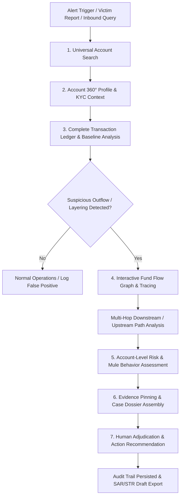
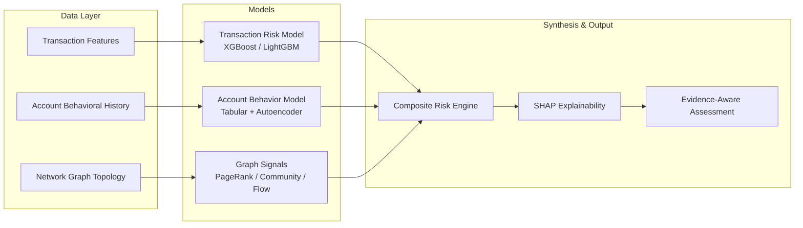
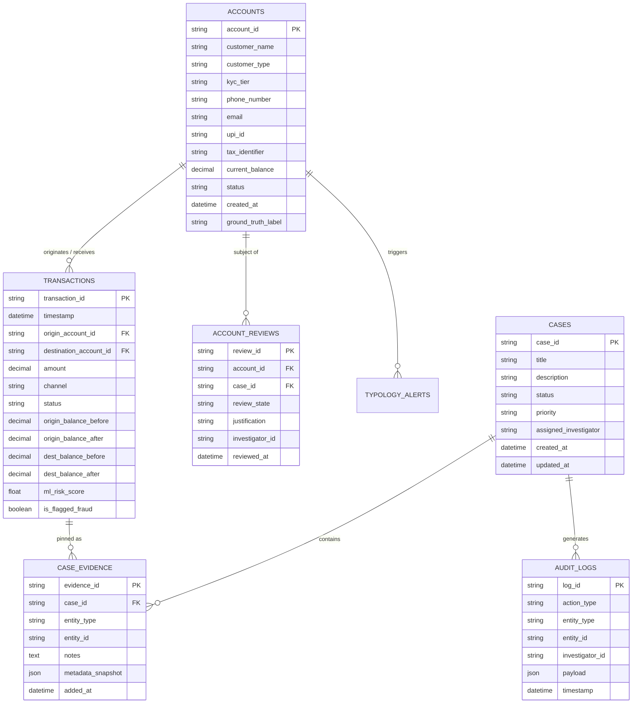
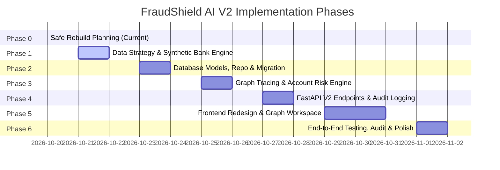

# FraudShield AI V2: Strategic Rebuild & Architecture Blueprint
**Forensic Account Intelligence, Multi-Hop Fund Tracing & Evidence-Based Investigation**

---

## 1. Executive Summary & Product Vision

### 1.1 Context and Motivation
FraudShield AI V1 established a solid proof-of-concept for single-transaction fraud classification (using an XGBoost model trained on PaySim) and basic case-associated transaction tracing. However, modern financial crime investigations—such as cyber-fraud networks, multi-layered money mule rings, authorized push payment (APP) scams, and smurfing operations—are fundamentally **account-centric and network-centric**, not isolated transaction events.

In operational financial intelligence units (FIUs) and bank fraud operations:
1. Investigators do not start with an isolated pre-cleared transaction; they receive an alert, victim FIR/complaint, or suspicious counterparty identifier (account number, phone, UPI VPA, email, tax identifier).
2. Investigators require the **complete available transaction history** of an account, establishing the customer's behavioral baseline before assessing anomalies.
3. Tainted funds disperse across downstream accounts within minutes. Investigators need **interactive, multi-hop downstream and upstream fund tracing** to determine where stolen money originated, through which intermediary mule hops it passed, and where it exited the banking perimeter (ATM cash-out, crypto on-ramp, merchant POS, overseas remittance).
4. Decisions must be backed by transparent, explainable evidence: statistical model scores must be cleanly separated from audited ledger facts, mathematical exposure tracking, and human compliance determinations.

### 1.2 Core Product Goals for V2
* **Universal Account Search & 360° Profile**: Search any account, customer name, tax ID, phone, or payment handle with sub-second retrieval of KYC tier, historical volume, risk posture, and counterparty network.
* **Complete Available Transaction History**: Deep chronological ledger with bidirectional filtering, dual-entry accounting views, velocity metrics, and inline transaction-level risk indicators.
* **Deterministic, Multi-Hop Downstream & Upstream Fund Tracing**: Graph traversal engine calculating exact mathematical fund attribution (FIFO / proportional dilution), hop latency, pass-through ratio, and terminal node identification.
* **Account-Level Fraud-Risk Assessment**: Composite scoring engine synthesizing behavioral baseline deviation (z-scores, sudden dormancy break), graph topological signals (mule ring participation, in/out degree asymmetry), transaction anomaly density, and watch-list matches.
* **Evidence-Based Investigation & Compliance Dossier**: Case binder enabling investigators to pin transactions, bookmark graph subgraphs, attach audit notes, record adjudications, and generate regulatory filings (SAR/STR drafts) with full audit trails.
* **Strict Ethical & Legal Guardrails**: Clear conceptual and visual distinction between *Model Probability*, *Observed Ledger Movement*, *Traceable Exposure*, and *Human Compliance Verdict*. Automated actions are strictly advisory; no account is ever automatically frozen or accused of guilt.

---

## 2. End-to-End Investigator Workflow



### Phase-by-Step Workflow Walkthrough

1. **Intake & Search**:
   - The investigator enters an identifier: e.g., Account Number (`ACC-904218`), UPI ID (`victim.sender@okhdfcbank`), Phone (`+91 98765 43210`), or Name into the universal global search bar.
   - Typeahead auto-complete returns matched entities with entity type, current risk band, and customer segment.

2. **Account 360° Dossier Review**:
   - The investigator lands on the Account 360° view displaying:
     - Account metadata: Opening date, customer segment (Retail, SME, Corporate, Student), KYC status, risk tier.
     - Financial summary: Current balance, 30-day inflow/outflow, average daily balance, primary transaction channels.
     - Composite Account Risk Score (0–100) with breakdown: Behavioral Anomaly Score, Mule Network Centrality, and High-Risk Counterparty Exposure.

3. **Transaction History Scrubbing & Anomaly Detection**:
   - Complete ledger displayed in reverse chronological order with pagination and virtual scrolling.
   - Interactive filters: Date range, transaction type (UPI, IMPS, NEFT, RTGS, Wire), direction (Inflow/Outflow), amount thresholds, and risk score filter.
   - Anomaly highlighting: Transactions flagged with high ML risk, sudden volume surges compared to 90-day moving averages, or rapid sequential round-tripping.

4. **Multi-Hop Fund Tracing & Interactive Graph Canvas**:
   - Clicking **"Trace Downstream Funds"** from a specific suspicious transaction or account launches the forensic graph engine.
   - Graph visualizes:
     - Root source node (victim / originator).
     - Hop-by-hop fund transfers with edge thickness proportional to amount and edge color indicating transfer latency (e.g., <5 min = rapid pass-through).
     - Layering nodes (mules, splitters, aggregators).
     - Terminal exit points (ATM withdrawals, crypto exchanges, overseas transfers, merchant POS).
   - Dynamic controls: Hop depth slider (1–7 hops), minimum dollar filter, time-window constraints, and layout switching (Hierarchical Dagre vs. Force-Directed).

5. **Account-Level Risk & Signal Breakdown**:
   - Investigator inspects the target or any downstream node in the graph side-panel:
     - Rapid retention ratio: Does the account retain funds (>24h) or immediately offload them (<15 min)?
     - Structural role: Fan-out hub (smurfing/dispersal), Fan-in hub (aggregator), Pass-through conduit, or Terminal sink.
     - SHAP explainability waterfall explaining top contributing behavioral features.

6. **Evidence Dossier & Case Management**:
   - Investigator clicks **"Add to Case"** to create a new case or attach to an existing inquiry.
   - Pins specific transactions as evidence items with custom annotations.
   - Takes a timestamped graph snapshot of the money flow topology.

7. **Adjudication, Audit Logging & Regulatory Export**:
   - Investigator records a verified review state: `Under Investigation`, `Escalated to Compliance`, `High-Risk Mule Confirmed (Human Verified)`, or `Legitimate Counterparty / False Positive`.
   - All actions, viewings, and state changes append an immutable entry to `audit_logs`.
   - One-click generation of a standardized Suspicious Activity Report (SAR / STR) narrative ready for compliance submission.

---

## 3. Data Strategy & Foundation

### 3.1 Audit of Existing PaySim Dataset
The repository currently houses `data/raw/PS_20174392719_1491204439457_log.csv` (471 MB, 6,362,620 rows).

| Dimension | PaySim Current State | Impact on V2 Rebuild |
| :--- | :--- | :--- |
| **Row Schema** | `step, type, amount, nameOrig, oldbalanceOrg, newbalanceOrig, nameDest, oldbalanceDest, newbalanceDest, isFraud, isFlaggedFraud` | Missing customer profiles, channels, geolocation, device identifiers, narrative descriptions. |
| **Account Continuity** | Origin accounts (`nameOrig`) appear only once or twice. Average transactions per orig account is ~1.01. | **Fatal limitation for account profiling**: Impossible to construct authentic 90-day baselines, customer behavioral histories, or account tenure dynamics. |
| **Network Structure** | Star-like 1-hop transactions (`TRANSFER` followed immediately by `CASH_OUT`). | Lacks realistic multi-tier laundering topologies: no cyclic flows, no complex fan-out/fan-in layering, and no multi-hop mule chains. |
| **Balance Accuracy** | Destination balances (`oldbalanceDest`, `newbalanceDest`) are frequently zero or erroneous for merchant accounts (`M...`). | Prevents rigorous ledger reconciliation and dual-entry balance audit validation. |
| **Label Scope** | Transaction-level binary label `isFraud` only. | No account-level classifications (`money_mule`, `compromised_victim`, `shell_corporation`, `legitimate_merchant`). |
| **Role in V2** | Retained strictly as a **benchmark reference for single-leg transaction classifiers**. | **Cannot serve as the operational database or graph dataset for V2.** |

### 3.2 Evaluation of IBM AMLSim
IBM AMLSim (Agent-based Financial Network Simulator) models synthetic banking transactions with explicit anti-money laundering (AML) topologies:
* **Advantages**: Generates multi-agent graph topologies with predefined AML transaction typologies (Cycle, Fan-In, Fan-Out, Scatter-Gather, Bipartite Matching). Preserves persistent account IDs over multiple simulated days.
* **Limitations**:
  - Heavy Java runtime dependencies with complex configuration YAMLs.
  - Generates rigid, minimal schemas lacking rich modern retail banking metadata (UPI handles, device fingerprints, KYC tiers, customer occupations, contact details).
  - Data generation is stochastic and often produces disconnected networks unless heavily tuned.
* **Evaluation Decision**: Adopt the **architectural concepts and graph typologies** of AMLSim (especially the layering topologies), but implement a clean, lightweight, reproducible Python generation engine native to the repository.

### 3.3 Proposed Reproducible Synthetic Banking Data Generator
For V2, we will design a dedicated, seed-controlled Python generator (`scripts/generate_synthetic_bank_data.py`) with complete deterministic reproducibility (`--seed 42`).

#### Generated Entity Scale
* **Accounts**: 10,000 synthetic banking accounts spanning Retail, HNW, Student, SME, Corporate, and Shell accounts.
* **Time Span**: 180 simulated calendar days with authentic timestamps, diurnal transaction frequency, and weekend distribution.
* **Transactions**: 350,000+ continuous transactions preserving strict balance integrity ($balance_{t} = balance_{t-1} + credit - debit$).
* **Network Nodes & Edges**: Interconnected multi-bank network simulating realistic payment rails (UPI, IMPS, NEFT, RTGS, SWIFT).

#### Injected Financial Crime & Fraud Topologies
1. **APP Scam / Stolen Fund Layering (Linear Mule Chain)**:
   - *Victim (Retail)* $\xrightarrow{\text{Large Transfer}}$ *First-Hop Mule (Account Takeover)* $\xrightarrow{\text{Split 10 min}}$ *Mule 2 & Mule 3* $\xrightarrow{\text{Fast}}$ *Crypto On-Ramp / ATM Withdrawal*.
2. **Structuring / Smurfing (Fan-In Aggregation)**:
   - 12 distinct low-balance accounts transfer amounts just below reporting thresholds ($9,500 / ₹49,000) within 48 hours to a single collector account.
3. **Dispersal / Scatter (Fan-Out Layering)**:
   - A single compromised corporate payroll account transfers funds to 25 newly created student accounts, which immediately cash out.
4. **Circular / Round-Tripping (Cycle Topology)**:
   - Layered movement through shell business accounts returning to an affiliate to inflate volume or obscure ownership ($A \to B \to C \to D \to A$).
5. **Dormant Account Awakening (Rapid Pass-Through)**:
   - Account inactive for 120 days suddenly receives $75,000 and dissipates 98.5% within 18 minutes.

#### Ground-Truth Account Labels
* `legitimate_retail`: Standard citizen consumer profile.
* `legitimate_merchant`: High transaction count, predominantly incoming credits, high retention.
* `compromised_victim`: High-tenure authentic account subjected to unauthorized drain.
* `mule_first_hop`: Immediate recipient of illicit funds, low retention time.
* `mule_intermediate_layer`: Splitting and forwarding intermediary node.
* `mule_aggregator`: Funnel node collecting structured deposits.
* `cashout_terminal`: Final dissipation endpoint.

---

## 4. Machine Learning & Analytical Modeling Plan



### 4.1 Model 1: Transaction-Level Classifier (T-Model)
* **Objective**: Evaluate the immediate risk of a single payment leg prior to settlement.
* **Architecture**: LightGBM / XGBoost classifier trained on transaction context.
* **Feature Schema**:
  - Payment rail, hour of day, day of week.
  - Transfer amount relative to sender's 30-day average ($amount / \mu_{amount}$).
  - Transfer amount relative to sender's current balance ($amount / balance_{orig}$).
  - Time elapsed since sender's previous transaction.
  - Counterparty novelty indicator (has sender ever transferred to this receiver before?).
  - Velocity features (outflow count in past 1h, 6h, 24h).
* **Target Output**: $P(\text{illicit transaction} \mid \text{transaction context}) \in [0, 1]$.

### 4.2 Model 2: Account-Level Behavioral Model (A-Model)
* **Objective**: Classify the systemic operational risk of an account over rolling 7, 30, and 90-day observation windows.
* **Architecture**: Hybrid ensemble combining:
  1. Supervised Gradient Boosted Trees for mule typology classification.
  2. Unsupervised Isolation Forest / Autoencoder for detecting zero-day behavioral deviations from peer cohort.
* **Feature Schema**:
  - *Retention Dynamics*: Flow-through ratio ($\frac{\text{Outflow within 24h}}{\text{Inflow within 24h}}$), average fund dwell time.
  - *Volume Volatility*: Z-score of weekly transaction count and aggregate turnover versus 90-day baseline.
  - *Time-of-Day Entropy*: Spread of transaction hours (automated bots operate at 3 AM; legitimate retail follows circadian rhythms).
  - *Counterparty Diversity*: Unique recipient ratio ($\frac{\text{Unique Destinations}}{\text{Total Outbound Transfers}}$).
  - *Balance Depletion Frequency*: Frequency with which account balance drops below 2% of pre-deposit levels within 1 hour.
* **Target Output**: Account Mule Risk Probability $P(\text{Mule} \mid \text{Account History}) \in [0, 1]$ and Anomaly Index.

### 4.3 Graph-Based Structural Signals (G-Signals)
Calculated via graph algorithms over the directional transaction network:
* **Degree In/Out Ratio**: Disproportionate fan-in or fan-out signatures.
* **Flow Centrality & Betweenness**: High betweenness centrality in fund transfer chains indicates critical money forwarding hubs.
* **Cycle Participation**: Detection of directed cycles of length 3 to 6 hops using Tarjan's algorithm.
* **Tainted Fund Reachability**: Distance in hops from known victim accounts or verified high-risk nodes.
* **Community Laundering Density**: Louvain community detection to isolate tightly clustered high-velocity transfer rings.

### 4.4 Explainability & Interpretability
* **Feature Attribution**: TreeSHAP values computed on both T-Model and A-Model.
* **Human-Readable Explanations**: SHAP values translated into structured investigative reason codes:
  - *"Account retained only 1.2% of inbound funds for longer than 15 minutes (contributed +38% to risk)."*
  - *"Transaction amount is 8.4x higher than the account's 90-day average (contributed +24% to risk)."*
  - *"Account exhibits 14 inbound transfers from distinct sources followed by 1 consolidated outflow (fan-in pattern)."*
* **Evidence Gaps**: The model explicitly highlights missing evidence (e.g., *"Device IP not yet captured"*, *"Counterparty is an unverified external bank"*).

---

## 5. Architectural Blueprint

### 5.1 System Architecture Overview

```mermaid
graph TB
    subgraph Client Layer [Frontend - React 19 / TypeScript / Vite]
        UI_SEARCH[Universal Search Bar]
        UI_360[Account 360° Profile]
        UI_TX[Ledger & History Viewer]
        UI_GRAPH[Cytoscape Fund Flow Canvas]
        UI_CASE[Case Management & Dossier]
        UI_GOV[Model Governance & SHAP]
    end

    subgraph API Gateway [FastAPI / Uvicorn]
        ROUTER_ACC[Accounts API /api/v2/accounts]
        ROUTER_TX[Transactions API /api/v2/transactions]
        ROUTER_TRACE[Tracing API /api/v2/trace]
        ROUTER_CASE[Cases API /api/v2/cases]
        ROUTER_AUDIT[Audit API /api/v2/audit]
        ROUTER_ML[ML Intelligence API /api/v2/models]
    end

    subgraph Service Layer [Core Logic]
        SVC_ACC[Account Profiler Service]
        SVC_TRACER[Deterministic Multi-Hop Tracer Engine]
        SVC_GRAPH[Graph Topology & Network Builder]
        SVC_RISK[Hybrid Risk & Mule Scoring Service]
        SVC_CASE[Case Management & Evidence Service]
        SVC_AUDIT[Tamper-Evident Audit Logger]
    end

    subgraph Storage & Analytics Layer
        DB_SQL[(Relational DB: SQLite / PostgreSQL)]
        GRAPH_CACHE[NetworkX / Graph Index]
        ML_STORE[Joblib / ONNX Model Artifacts]
    end

    Client Layer --> API Gateway
    API Gateway --> Service Layer
    Service Layer --> DB_SQL
    Service Layer --> GRAPH_CACHE
    Service Layer --> ML_STORE
```

### 5.2 Frontend Technology Stack & UI Philosophy
* **Framework**: React 19, TypeScript, Vite.
* **Styling**: Tailwind CSS with custom forensic design tokens (neutral slate foundation, high-contrast indicators, glassmorphic floating toolbars).
* **Graph Visualization**: Cytoscape.js with Dagre layout (for directional hierarchical fund flows) and Cola layout (for clustering). Enhanced with WebGL / Canvas fallbacks for sub-second rendering of networks up to 5,000 edges.
* **Component Primitives**: Lucide-React icons, Radix UI primitives, Recharts for timeline distributions and behavioral radar charts.
* **State Management**: Lightweight Zustand stores separating active search state, selected account context, graph canvas viewport, and active case binder.

### 5.3 Backend Technology Stack
* **Framework**: FastAPI (Python 3.11+) with asynchronous ASGI processing.
* **Validation & Schemas**: Pydantic V2 with strict type coercion and serialization.
* **Data Access**: SQLAlchemy 2.0 (AsyncIO) with Alembic migration scripts.
* **Database Engine**:
  - *Development & Standalone Mode*: SQLite with WAL mode enabled.
  - *Enterprise / Production Target*: PostgreSQL 16+ with recursive query support (`WITH RECURSIVE`) and indexes on `(origin_account_id, timestamp)` and `(destination_account_id, timestamp)`.
* **Graph Engine**: In-memory NetworkX graph instance synchronized with the relational transaction ledger, supporting $O(V + E)$ multi-hop BFS and shortest-path queries.

---

## 6. API & Database Entity Outline

### 6.1 Database Schema (Entities & Relationships)



### 6.2 REST API Specification

#### Account Management & Search
* `GET /api/v2/accounts/search?q={query}&type={name|account|upi|phone}&limit=20`
  - Searches accounts across multiple identifiers with fuzzy and exact matching.
* `GET /api/v2/accounts/{account_id}`
  - Fetches the comprehensive 360° profile, KYC status, aggregate statistics, and risk band.
* `GET /api/v2/accounts/{account_id}/transactions?start_date=&end_date=&direction=&channel=&min_amount=&max_amount=&limit=50&offset=0`
  - Returns paginated chronological transactions with running balance and ML transaction scores.
* `GET /api/v2/accounts/{account_id}/risk-assessment`
  - Returns composite account score, behavioral metrics, SHAP feature importance, and evidence gaps.

#### Fund Tracing & Forensic Graph
* `POST /api/v2/trace/downstream`
  - Request body: `{ "root_account_id": "ACC-101", "transaction_id": "TX-998", "max_hops": 5, "min_amount": 500, "time_window_hours": 72 }`
  - Returns multi-hop directed tree with nodes, edges, hop latency, traceable exposure amounts, and terminal sinks.
* `POST /api/v2/trace/upstream`
  - Traces the origin of funds entering a target account across preceding hops.
* `GET /api/v2/graph/neighborhood/{account_id}?depth=2`
  - Returns immediate ego-network showing primary counterparties and edge volumes.

#### Cases, Evidence & Audit
* `GET /api/v2/cases` & `POST /api/v2/cases`
  - List and create investigation cases.
* `GET /api/v2/cases/{case_id}`
  - Retrieve case details, pinned evidence items, attached accounts, and audit log.
* `POST /api/v2/cases/{case_id}/evidence`
  - Pin a transaction, account, or graph snapshot to a case binder.
* `PUT /api/v2/accounts/{account_id}/review`
  - Update human adjudication status (`under_investigation`, `mule_confirmed`, `cleared`).
* `GET /api/v2/cases/{case_id}/export/sar`
  - Generates a formatted Suspicious Activity Report (SAR) XML/JSON draft with narrative text.

---

## 7. Ethical Guardrails & Separation of Concepts

A critical flaw in naive AI fraud systems is conflating a high model score with a declaration of criminal guilt. In FraudShield AI V2, every layer of the data model and UI strictly separates four distinct concepts:

| Dimension | Definition | Source of Truth | Permitted Action | Prohibited Action |
| :--- | :--- | :--- | :--- | :--- |
| **1. Model Risk** | Statistical probability estimated by machine learning based on tabular/graph patterns ($0.00$ to $1.00$). | Machine Learning Models (LightGBM, XGBoost, Isolation Forest) | Prioritize analyst review queue; suggest investigation paths. | **Never** used to auto-freeze accounts, deny customer access, or declare guilt. |
| **2. Observed Money Movement** | Immutable ledger debits and credits recorded chronologically in the bank's core ledger. | Core Banking Ledger / SQL Transactions Table | Establish verified timeline of facts and actual cash balances. | Cannot infer malicious intent on its own (merchants receive funds innocently). |
| **3. Traceable Exposure** | Mathematical fund attribution calculating the ceiling of tainted funds flowing through an account. | Deterministic FIFO / Flow Attribution Engine | Calculate maximum recoverable balance across downstream hops. | Does not imply the receiving account holder had knowledge of the crime. |
| **4. Human-Verified Outcome** | Formal adjudication recorded by an authorized, credentialed investigator. | Human Compliance Analyst via Audit-Logged Review API | File SAR/STR, initiate formal law enforcement inquiry, apply account restriction. | Unchecked or unlogged decisions without justification. |

---

## 8. UI Pages & Forensic Workspace Architecture

### 8.1 Page Breakdown

1. **Universal Search & Operations Hub (`/` & `/search`)**:
   - Hero command-palette style search with support for account numbers, customer names, UPI IDs, phone numbers, and case IDs.
   - Live triage queue: High-priority algorithmic alerts, newly reported victim complaints, and open cases.
   - System metrics summary: Total monitored accounts, 24h traced exposure, open investigations.

2. **Account 360° Profile & Transaction Ledger (`/accounts/:id`)**:
   - *Header & Identity*: Customer details, KYC badge, tenure, current balance, and quick action bar ("Open Trace", "Attach to Case", "Flag for Review").
   - *Risk Synthesis Card*: Radial score dial with risk band (Low, Elevated, High, Severe) and top 3 contributing factors.
   - *Behavioral Baseline Widgets*: 30-day turnover trend, diurnal hour distribution, channel breakdown (UPI vs. NEFT vs. Wire).
   - *Transaction History Table*: Dual-entry ledger view, sortable, searchable, with inline risk pills, counterparty links, and quick-trace buttons.

3. **Interactive Fund Flow Canvas (`/accounts/:id/trace` & `/cases/:id/graph`)**:
   - Fullscreen interactive Cytoscape canvas.
   - Dynamic node styling:
     - Blue: Origin / Victim account.
     - Amber: Intermediate pass-through mule.
     - Red: High-risk aggregator or syndicate hub.
     - Violet: Terminal cash-out / Crypto / External bank.
   - Interactive Edge Inspector: Shows exact amount, payment channel, elapsed time from parent hop, and traceable fund portion.
   - Floating Control Deck: Hop depth slider, minimum amount cutoff, layout selector (Hierarchical Dagre, Circular, Force-Directed), and "Snapshot to Case" button.

4. **Case Investigation Dossier (`/cases` & `/cases/:id`)**:
   - Case details, status, priority, and assigned investigator.
   - Pinned Evidence Binder: Cards for pinned transactions, accounts of interest, and saved graph visual states.
   - Investigator Notes & Timeline: Collaborative scratchpad with markdown support and immutable activity logs.
   - Adjudication Panel: Formal review status updater with mandatory rationale text.
   - SAR/STR Export Modal: Automatically compiles case facts, transaction table, and narrative into a regulatory submission draft.

5. **Model Governance & Intelligence Console (`/models/governance`)**:
   - Model cards for T-Model and A-Model detailing training dataset provenance, validation splits, precision-recall curves, and ROC-AUC.
   - Global feature importance (SHAP summary plots).
   - Drift detection monitors tracking population stability index (PSI) and prediction distribution over time.

---

## 9. Testing, QA & Quality Strategy

### 9.1 Unit & Service Tests
* **Backend (Pytest)**:
  - `test_synthetic_generator.py`: Verifies deterministic seed output, ledger balance integrity ($\sum credits - \sum debits = \Delta balance$), and correct topology injection.
  - `test_deterministic_tracer.py`: Validates conservation of funds, FIFO vs. proportional dilution calculations, cycle termination (no infinite loops in circular graphs), and hop-depth limits.
  - `test_account_risk_scoring.py`: Tests composite scoring formulas, boundary edge cases (zero-balance, newly opened accounts), and SHAP attribution generation.
  - `test_case_management.py`: Verifies case creation, evidence pinning, immutable audit log generation, and role authorization.
* **Frontend (Vitest & Testing Library)**:
  - Unit tests for search debouncing, ledger filter logic, and risk badge formatting.
  - Component tests for graph node selection, side-drawer expansion, and case evidence pinning.

### 9.2 End-to-End Verification (Playwright / Chrome DevTools)
* Automated browser test exercising the complete forensic investigative loop:
  1. Open search $\to$ Query synthetic account `ACC-MULE-4812`.
  2. Verify 360° profile renders with complete transaction ledger.
  3. Click "Trace Downstream Funds" $\to$ Validate Cytoscape canvas renders 3 downstream hops.
  4. Select downstream hop $\to$ Pin transaction to a new investigation case.
  5. Navigate to Case Dossier $\to$ Verify pinned evidence, add investigator notes, and record human adjudication.
  6. Export SAR draft and verify audit log entry.

### 9.3 Code Quality & Tooling
* Backend: `ruff` (linter and formatter), `mypy` (strict static type checking), `pytest-asyncio`.
* Frontend: `eslint`, `prettier`, `tsc --noEmit`.

---

## 10. Phase-by-Phase Implementation Roadmap & Acceptance Criteria



### Phase 0: Safe Rebuild Planning (Current Phase)
* **Goal**: Establish the comprehensive architectural blueprint, inspect existing assets, and ensure clean Git branch setup without modifying existing implementation.
* **Acceptance Criteria**:
  - [x] Repository inspected; existing code, models, and PaySim dataset preserved.
  - [x] Clean Git branch `v2-rebuild` created off latest `origin/main` and pushed to remote.
  - [x] `docs/V2_REBUILD_PLAN.md` authored with exhaustive domain, data, model, API, and UI blueprints.
  - [x] Zero packages installed, zero V1 code deleted or broken.

### Phase 1: Data Strategy & Reproducible Synthetic Banking Generator
* **Goal**: Build the offline reproducible synthetic generator producing realistic accounts, continuous transaction history, and financial crime topologies.
* **Acceptance Criteria**:
  - `scripts/generate_synthetic_bank_data.py` created with `--seed` parameter.
  - Generates 10,000+ accounts with complete KYC profiles and 350,000+ continuous transactions.
  - Explicitly injects 5 verified topologies (APP scam layering, structuring fan-in, fan-out dispersal, cyclic round-tripping, dormant awakening).
  - Validation script tests that ledger balances strictly reconcile and ground-truth labels are generated.

### Phase 2: Database Schema, ORM Entities & Data Persistence
* **Goal**: Implement SQLAlchemy async models and SQLite/PostgreSQL schema for accounts, transactions, cases, evidence, reviews, and audit logs.
* **Acceptance Criteria**:
  - Clean ORM models defined in `backend/app/models/v2/`.
  - Alembic migration scripts created and tested.
  - Ingestion CLI to populate the database from the synthetic generator output with sub-30-second ingest speed.
  - Indexes verified on account identifiers, timestamps, and foreign keys.

### Phase 3: Forensic Graph Tracing Engine & Hybrid Risk Scoring
* **Goal**: Build the core analytical engines for multi-hop fund attribution and account-level risk classification.
* **Acceptance Criteria**:
  - Deterministic multi-hop tracer supporting configurable hops, time windows, and FIFO / proportional fund attribution.
  - In-memory graph index with cycle-safe traversal.
  - Account-level risk engine synthesizing behavioral anomaly z-scores, velocity, and topological signals.
  - SHAP explanation generator translating feature impacts into natural-language reason codes.
  - 100% test coverage on tracer fund conservation and cycle termination.

### Phase 4: Backend REST API V2 & Audit Logging
* **Goal**: Expose robust, typed FastAPI v2 endpoints for search, 360° profile, ledger history, fund tracing, case management, and audit logging.
* **Acceptance Criteria**:
  - Endpoints under `/api/v2/` operational with Pydantic V2 response schemas.
  - Universal search endpoint supports prefix and fuzzy matching on account, phone, UPI, and name.
  - Immutable audit logger records all investigator actions and adjudications.
  - Comprehensive Pytest test suite covering all API routes and error conditions.

### Phase 5: Modern Forensic Frontend Workspace
* **Goal**: Build the brand new investigator user interface from the ground up (Universal Search, Account 360°, Interactive Cytoscape Canvas, Case Dossier).
* **Acceptance Criteria**:
  - React 19 / Vite frontend implemented with curated dark forensic aesthetic.
  - Fast universal search with autocomplete.
  - Complete transaction ledger with virtualized table, multi-column filtering, and inline risk pills.
  - Interactive Cytoscape graph canvas with zoom, pan, hop expansion, edge inspectors, and layout toggle.
  - Case management dossier allowing evidence pinning and adjudication persistence.

### Phase 6: End-to-End Verification, Documentation & Production Readiness
* **Goal**: Complete full integration testing, end-to-end browser verification, performance optimization, and project documentation.
* **Acceptance Criteria**:
  - Playwright automated test verifies the complete investigator journey from search to SAR export.
  - Zero TypeScript errors, clean linting (`ruff`, `eslint`).
  - Updated `README.md` and user guide with visual screenshots and architecture diagrams.
  - Final review confirming strict separation between model scores and human adjudications.

---

*Document finalized for Phase 0 sign-off. Do not begin Phase 1 until explicit user approval is granted.*
